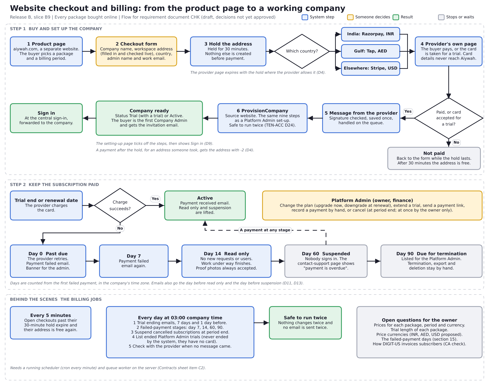

# CHK: Website checkout and subscription billing (requirements)

**Module requirements for Release B, slice B9** | Covers register items CHK-01 to CHK-07 and BIL-01 to BIL-05, and one proposed item | Based on Blueprint v3.17 | **Draft for developer review. Decisions proposed, waiting for owner approval** | November 19, 2026

Labels in this document use the default words (service request, technician, site). In the product every renamed word goes through the `term()` helper. Money is shown with the decimals of its currency.

## 1. Purpose and scope

This module lets a company **buy a package on the aiywah.com product page and start working without anyone at Aiywah setting it up**, and then keeps that company's subscription paid. A visitor picks a package and a billing period, fills in a short form, pays on the payment provider's own page, and the company is created as soon as the provider confirms. The buyer becomes the first Company Admin and receives the invitation email.

In Release A a Platform Admin creates every company by hand (the New workspace screen and the `ProvisionCompany` job with source `platform_admin`), trials never end by themselves (TEN-ACC D10), and a company changes its plan by contacting Aiywah. This module adds the second way in that blueprint decision 60 describes, and the billing that follows it. Both ways run the same set-up job.

**In scope (12 register items and one proposed)**

- **Checkout:** CHK-01 public package list, CHK-02 checkout form, CHK-06 create a company from a payment.
- **Payment providers:** CHK-03 Stripe, CHK-04 Tap, CHK-05 Razorpay.
- **Billing:** BIL-01 subscription lifecycle, BIL-02 daily billing job, BIL-03 Subscriptions page for the Platform Admin, BIL-04 billing notices, BIL-05 plan change.
- **Tests:** CHK-07, for the checkout and billing part.
- **Proposed (D19):** CHK-08, a read-only Plan and billing page for the Company Admin.

**Out of scope for this module**

- The guided WhatsApp sign-up (WAG-01 to WAG-03). It is in slice B9 but belongs to the Notifications module and waits for Aiywah's verified Meta business account. It gets its own short document.
- The product page itself. It is a separate website for all Aiywah products (decision 61). This module gives it the package list and the checkout.
- Customers upgrading, downgrading or cancelling by themselves. After launch (decision 65).
- One login across Aiywah products (decision 67).
- Terminating a company and deleting its data after non-payment. This module lists companies that are due for it. The Platform Admin acts by hand (D11).
- The wording and numbering of DIGIT-US's own tax invoices to subscribers. It waits for the CA check (open action). This module keeps the amounts it needs (D14).

**Needs first:** the Release A set-up job (`ProvisionCompany`), plans and the plan gate, suspend and reactivate (TEN-06), the sign-in emails and their sender, and a running scheduler and queue worker on the server (Contracts decision sheet, item C2). **Needed by:** nothing else in Release B. It stands alone.

**Sources.** Blueprint v3.17 sections 3, 5, 6, 11.3, 12.2, 14 (decisions 60 to 67 and 68 to 90) and 15, the Release B scope register, the Release B overview, and the code as it stood on November 19, 2026 (`ProvisionCompany`, `TenantController`, the `tenants` and `plans` columns).

**Gaps and conflicts found between the existing documents.** Each has a decision below.

1. **The Tenancy spec section was not available for this draft.** The register and the overview say checkout is designed in `TEN-ACC.md` section 11 (decisions D24 to D31, tests AT-70 to AT-78). Only D24 is known, from the code: the set-up job does nothing for a checkout reference it has already used. Every decision below must be checked against TEN-ACC section 11 before approval. Where they differ, TEN-ACC wins unless the owner changes it.
2. **Laravel Cashier against the blueprint's own table.** Blueprint section 3 says "Laravel Cashier for Stripe, plus a gateway table for Tap and Razorpay". Blueprint 11.3 defines one `gateway_subscriptions` table for all three providers. Cashier keeps its own tables and expects a billable user. D21 proposes one gateway layer for all three.
3. **The failed-payment rule is only a proposal.** Register BIL-01 says "spec needed: failed payment grace period and what suspension does". Blueprint section 15 proposes a timeline (warn after 7 days, read only after 14, suspended after 60, terminated after 90). D11 adopts it, with termination by hand.
4. **Read only has no place in the schema.** `tenants.status` is trial, active, suspended or terminated. The read-only stage of section 15 needs its own column (SCH-B9-06).
5. **Prices have no table.** Blueprint `plans.gateway_price_ids_json` holds provider price IDs but no amounts, and the product page must show amounts in each currency. The code's `plans` table has neither. D6 and SCH-B9-03 propose a price table.
6. **The trial length has no column.** Decision 64 says the owner sets a free trial for each package. SCH-B9-05 adds `plans.trial_days`.
7. **Field names differ between the blueprint and the code.** Blueprint `trial_ends_at`, `country_code`, `currency_code`, `features_json` and `max_users` are `trial_ends_on` (a date), `country`, `base_currency`, `features` and `user_limit` in the code. This document uses the code's names.
8. **`gateway_subscriptions` does not exist yet** in the database (checked November 19, 2026). SCH-B9-01 creates it.
9. **Trials made by a Platform Admin have no card.** TEN-ACC D10 says trials do not end by themselves in Release A. Website trials end through the provider. D12 says what happens to the others.
10. **The 30-minute address hold against the provider page.** Decision 62 holds the address for 30 minutes, but a buyer can still be on the provider's page after that. D4 covers it.
11. **Where the form lives.** Decision 62 says the address is chosen "on our form". It does not say whether the form is on aiywah.com or in the product. D2 decides.
12. **Time zone and base currency of the new company.** The set-up job falls back to Asia/Kolkata and no currency. The form must supply both (D6).
13. **Central sign-in.** Since November 18, 2026 every company signs in from one address and is forwarded to its own. The workspace address is still needed (TEN-ACC D2), but most buyers never type it. D3 fills it in for them.
14. **Termination and data export** (section 15, 90 days and 30 days) are not in the B9 register. D11 keeps them as Platform Admin actions.

**Where each register item is specified**

| Item | What | Screens | Rules | Tests |
|---|---|---|---|---|
| CHK-01 | Public package list | 5.1 | 6.1 | CB-001 to CB-008 |
| CHK-02 | Checkout form | 5.2, 5.3 | 6.2, 6.3, 6.4 | CB-009 to CB-030 |
| CHK-03, CHK-04, CHK-05 | Stripe, Tap and Razorpay | 5.3 | 6.3, 6.4, 6.10 | CB-031 to CB-040 |
| CHK-06 | Create a company from a payment | 5.4 | 6.5 | CB-041 to CB-052 |
| BIL-01 | Subscription lifecycle | 5.5 | 6.6, 6.7 | CB-053 to CB-066 |
| BIL-02 | Daily billing job | | 6.8 | CB-067 to CB-074 |
| BIL-03 | Subscriptions page | 5.6, 5.7 | 6.9 | CB-075 to CB-084 |
| BIL-04 | Billing notices | | 7 | CB-085 to CB-091 |
| BIL-05 | Plan change | 5.7 | 6.9 | CB-092 to CB-097 |
| CHK-08 (proposed) | Plan and billing page | 5.8 | 6.11 | CB-098 to CB-100 |
| CHK-07 | Tests | | 10 | all, plus AT-70 to AT-78 |
| (all) | Permissions, isolation, security | | 6.11 | CB-101 to CB-110 |

## 2. Decisions to review before building

The blueprint, the register and section 15 did not settle these. Each has my recommendation. Write Approve or your change in the last column. Nothing here is final until you answer. D6, D7, D11 and D14 are the owner's calls (pricing, trial and failed payments are section 15 management items).

| # | Decision and recommendation | Your answer |
|---|---|---|
| D1 | **Who can buy and what.** Anyone on the product page can buy one company per checkout. The packages offered are the active plans that have a price for the buyer's currency and billing period. A package without a price shows "Contact us" and cannot be bought online (for example Enterprise). The buyer becomes the first Company Admin (decision 66). **Recommended: approve.** | |
| D2 | **Where the form lives.** The form is a page of the product at the root address (for example `fsm.aiywah.com/start`), next to the central sign-in. The product page links to it with the chosen package and period. The public endpoints of blueprint 12.2 (package list, address check, checkout session) stay available for the product page. One place keeps the checks, the 30-minute hold and the provider keys, and the product page can stay a simple website. **Recommended: approve.** | |
| D3 | **The workspace address.** The form fills it in from the company name (lowercase, spaces and other characters become hyphens, cut to 40 characters) and the buyer can change it. It is checked live against TEN-ACC D2 (3 to 40 lowercase letters, digits and hyphens, starting with a letter, not reserved), against existing companies and against addresses held by other open checkouts. The form shows it as "Your workspace: skyline.fsm.aiywah.com". **Recommended: approve.** | |
| D4 | **The 30-minute hold.** Submitting the form holds the address for 30 minutes (decision 62). The provider's page is set to expire at the same time where the provider allows it, so a payment cannot arrive for an address that is no longer held. If a provider cannot expire its page and a payment arrives after the hold for an address someone else has taken, the company is created with the first free address made by adding "-2", "-3" and so on, the invitation email shows it, and the Platform Admin sees a note on the subscription. **Recommended: approve.** | |
| D5 | **The provider follows the country** (decision 63). India: Razorpay. United Arab Emirates, Saudi Arabia, Qatar, Kuwait, Bahrain and Oman: Tap. Every other country: Stripe. The buyer cannot pick another provider. **Recommended: approve.** | |
| D6 | **Price currency and the company's own currency (owner).** The owner sets a price for each package, billing period and currency (open action). Recommended price currencies: INR for India, AED for the Gulf countries, USD for every other country. The company's base currency for its own quotes and invoices is a separate field on the form, filled from the country and editable, and its time zone is filled from the country the same way. **The owner's call.** | |
| D7 | **The free trial (owner).** Each package has a trial length in days, 0 for none (decision 64). With a trial, the card is taken at checkout and the first charge is made when the trial ends. The company is created when the checkout is completed, in status Trial, with `trial_ends_on` set. Without a trial, the company is created when the first payment is confirmed, in status Active. **The owner's call. Recommended: approve.** | |
| D8 | **Creating the company from the payment** (CHK-06). When the provider confirms, the system queues `ProvisionCompany` with source `website` and the provider's reference as the checkout reference. It runs the same nine steps as a Platform Admin set-up and then writes the subscription. It is safe to run twice: a second confirmation with the same reference changes nothing (TEN-ACC D24). The first Company Admin receives the invitation email (TEN-ACC D9, D18) and signs in through the central sign-in. **Recommended: approve.** | |
| D9 | **After paying.** The buyer returns to a page "Setting up your company" that ticks off the steps (TEN-ACC D20), then shows "Check your email for your invitation" and a Sign in button. If the confirmation has not arrived after 2 minutes, the page says the payment is received and an email will follow. If the buyer leaves the provider's page without paying, they return to the form with everything still filled in while the hold lasts. **Recommended: approve.** | |
| D10 | **Subscription states** (BIL-01). The subscription is Trialing, Active, Past due or Cancelled (`gateway_subscriptions.status`). The company follows it: Trialing gives company status Trial, Active gives Active, Past due keeps the company working with the stages of D11, and Cancelled keeps it working until the end of the paid period and then suspends it with the reason "Subscription ended". **Recommended: approve.** | |
| D11 | **Failed payments (owner, blueprint section 15).** Counted in days from the first failed payment, in the company's time zone. Day 0: the provider retries and every Company Admin gets "Payment failed". Day 7: a second email and a banner for the Company Admin. Day 14: **read only**: no new requests (from staff, the portal, QR scans or maintenance schedules) and no new users, while work already under way is finished and proof photos are always accepted. Day 60: **suspended** (TEN-ACC D10: nobody signs in, a contact-support page shows). Day 90: listed as **due for termination** on the Subscriptions page. Termination, the data export and deletion stay Platform Admin actions in this slice. A payment received at any stage returns the company to Active at once. A suspension lifts only if its reason was non-payment. **The owner's call. Recommended: approve.** | |
| D12 | **Trials made by a Platform Admin.** They have no card, so they are not ended by the system (TEN-ACC D10 stays). After `trial_ends_on` they show as "Trial ended" on the Subscriptions page, where the Platform Admin sends a payment link or suspends the company. **Recommended: approve.** | |
| D13 | **Billing notices** (BIL-04). Four emails to every active Company Admin: Trial ending (7 days and 1 day before), Payment received (amount, tax and period), Payment failed (day 0, day 7, the day before read only and the day before suspension) and Plan changed. They are system messages through the same sender and log as the sign-in emails (blueprint 9.7). No WhatsApp and no in-app item. **Recommended: approve.** | |
| D14 | **The tax invoice (owner).** The provider sends its own payment receipt. The tax invoice from DIGIT-US waits for the CA check (open action). This module stores the amount, tax, currency and period of every payment so an invoice can be made from it. **The owner's call.** | |
| D15 | **Plan change** (BIL-05). Only a Platform Admin with the owner or finance role. An upgrade takes effect at once and the provider charges the difference for the rest of the period. A downgrade and a change of billing period take effect at the next renewal. A downgrade keeps all data and makes gated data read only (blueprint section 6). The Company Admin gets "Plan changed". **Recommended: approve.** | |
| D16 | **Cancelling.** Only Aiywah staff cancel (decision 65): at the end of the current period by default, or at once with a reason (owner role only). **Recommended: approve.** | |
| D17 | **The Subscriptions page** (BIL-03). A Platform console page listing every company with its plan, period, provider, status, trial end or next renewal and days past due, with filters. A detail shows the payment events. Actions: change plan, cancel, extend a trial, send a payment link, refresh from the provider, and record a payment by hand with a reason (for a bank transfer). Owner and finance act. Support views (TEN-ACC D19 said finance is read only until billing arrives). **Recommended: approve.** | |
| D18 | **Payment events.** Every message from a provider is checked for its signature, saved once (provider and event ID are unique), handled on the queue and shown on the subscription. A message with a bad signature is refused. An event the module does not use is saved and ignored. **Recommended: approve.** | |
| D19 | **A Plan and billing page** (proposed CHK-08, not in the register). For the Company Admin and Operations Manager, like the Usage page. Read only, in company settings: plan, status, trial end or next renewal, price and period, and an "Update payment card" link to the provider's own page (Company Admin only). No upgrade or cancel buttons (decision 65): "To change your plan, contact Aiywah." **Recommended: approve, or drop it and rely on the emails.** | |
| D20 | **The package list** (CHK-01). A public list, with no sign-in, of every active plan that has a price: code, name, the feature lines of blueprint section 6, the limits, trial days, and the prices for each period and currency. Kept for 10 minutes. Nothing else about a plan is public. **Recommended: approve.** | |
| D21 | **One gateway layer instead of Cashier.** Each provider is reached through its own PHP library behind one gateway interface (start a checkout, read a subscription, change a plan, cancel, check a message signature). All three write the same `gateway_subscriptions` table. This needs a small change to blueprint section 3. **Developers to confirm, owner to sign the blueprint change.** | |
| D22 | **Abuse and abandoned forms.** The form allows 10 checkouts for each IP address in an hour. Nothing is created before payment, so an abandoned form leaves only a hold that expires. **Recommended: approve.** | |
| D23 | **Test mode.** Local and staging use each provider's test mode and test keys. Only production uses live keys. A test purchase on staging must create a working company before go-live (register, slice B9 exit). **Recommended: approve.** | |

**Schema additions (proposed)**

| Item | Change | Why |
|---|---|---|
| SCH-B9-01 | New table `gateway_subscriptions` as in blueprint 11.3, plus `tenant_id`, `price_currency`, `price_amount`, `past_due_since`, `last_payment_at`, `cancelled_at` and `cancel_reason` | The subscription of each company (D10, D11, D16) |
| SCH-B9-02 | New table `checkout_sessions` | The form, the 30-minute hold and the link to the provider (D3, D4, D9) |
| SCH-B9-03 | New table `plan_prices` | Amounts for each package, period and currency, with the provider's price ID (D6, D20) |
| SCH-B9-04 | New table `payment_events` | Every provider message, once (D18), and the payment amounts (D14) |
| SCH-B9-05 | `plans`: add `trial_days SMALLINT UNSIGNED NOT NULL DEFAULT 0` | Trial length for each package (D7) |
| SCH-B9-06 | `tenants`: add `read_only_since TIMESTAMP NULL`, and a unique index on `checkout_reference` if it is missing | The read-only stage (D11), and a database guard for D24 |

**New error codes (proposed)**

| Code | When |
|---|---|
| ADDRESS_NOT_AVAILABLE | The workspace address is taken, reserved, held by another checkout or breaks the address rules |
| PACKAGE_NOT_AVAILABLE | The package has no price for the buyer's currency and period, or is not active |
| CHECKOUT_EXPIRED | The hold has ended before the buyer reached the provider |
| PAYMENT_SIGNATURE_INVALID | A provider message fails its signature check |
| COMPANY_READ_ONLY | An action that read only blocks (D11) |

The blueprint codes FORBIDDEN, VALIDATION_FAILED, NOT_FOUND, RATE_LIMITED and COMPANY_SUSPENDED are used as they are.

## 3. Who can do what

| Action | Who |
|---|---|
| See packages, check an address, start a checkout, see the setting-up page | Anyone, no sign-in (rate limited) |
| See the Subscriptions page and payment events | Platform Admin: owner, support, finance |
| Change a plan, extend a trial, send a payment link, refresh from the provider, record a payment by hand | Platform Admin: owner, finance |
| Cancel a subscription at the end of the period | Platform Admin: owner, finance |
| Cancel at once | Platform Admin: owner |
| See the Plan and billing page (proposed) | Company Admin, Operations Manager (`settings.manage`, view), like the Usage page |
| Receive billing notices and the card link | Company Admin |
| See the past-due and read-only banners | Company Admin. Other staff see the read-only banner only |

No company permission key is added. The Plan and billing page uses `settings.manage` (view), like the Usage page (blueprint 7.9a). Only the Company Admin sees the Update payment card link.

## 4. Data this module reads and writes

- **Reads:** `plans`, `plan_prices`, `tenants`, `users` (Company Admins), `roles`, `tenant_settings`, `platform_users`.
- **Writes:** `checkout_sessions`, `gateway_subscriptions`, `payment_events`, `tenants` (status, `trial_ends_on`, `read_only_since`, suspension fields, and everything the set-up job writes), `activity_logs`, the message log of the sender.
- **Used by others:** the plan gate reads the plan (a plan change shows at once), sign-in reads the suspension, and request creation, user creation, the portal, QR scans and maintenance read `read_only_since`.

**New table: gateway_subscriptions** (blueprint 11.3 plus the added columns)

| Column | Type | Rule |
|---|---|---|
| tenant_id | BIGINT | One live subscription for each company |
| gateway | ENUM(stripe, tap, razorpay) | From the country (D5) |
| gateway_customer_id, gateway_subscription_id | VARCHAR(120) | From the provider. The pair gateway and subscription ID is unique |
| plan_id | BIGINT | The current plan |
| status | ENUM(trialing, active, past_due, cancelled) | As in D10 |
| billing_cycle | ENUM(monthly, annual) | |
| price_currency, price_amount | CHAR(3), DECIMAL(14,3) | The price in force |
| current_period_end | TIMESTAMP NULL | Next renewal or trial end |
| cancel_at_period_end | BOOLEAN | Default false (D16) |
| past_due_since | TIMESTAMP NULL | Set at the first failed payment, cleared by a payment (D11) |
| last_payment_at | TIMESTAMP NULL | |
| cancelled_at, cancel_reason | TIMESTAMP NULL, VARCHAR(255) NULL | |

**New table: checkout_sessions**

| Column | Type | Notes |
|---|---|---|
| public_token_hash | CHAR(64) | The token in the setting-up page address, stored hashed |
| plan_id, billing_cycle, price_currency, price_amount | | The package as bought |
| gateway | ENUM(stripe, tap, razorpay) | |
| company_name, slug, country, timezone, base_currency | | From the form |
| admin_name, admin_email | | The first Company Admin |
| status | ENUM(open, completed, provisioned, expired, failed) | open until paid or 30 minutes |
| hold_expires_at | TIMESTAMP | 30 minutes after the form is sent |
| gateway_session_id, checkout_reference | VARCHAR(120) NULL | From the provider |
| tenant_id | BIGINT NULL | Set when the company is created |
| ip_address, created_at | | For the rate limit |

Index on (slug, status, hold_expires_at) for the address check.

**New table: plan_prices**: `plan_id`, `billing_cycle` (monthly, annual), `currency` CHAR(3), `amount` DECIMAL(14,3), `gateway`, `gateway_price_id` VARCHAR(120) NULL, `is_active`. The triple plan, period and currency is unique.

**New table: payment_events**: `gateway`, `event_id` (unique with gateway), `type`, `tenant_id` NULL, `gateway_subscription_id` NULL, `amount`, `tax_amount`, `currency`, `period_start`, `period_end`, `payload` JSON, `received_at`, `processed_at` NULL, `error` NULL.

## 5. Screens

Screens use the standard web layout and work on a phone. Public pages use the Aiywah brand, not a company's brand. Status colours follow the reserved colours and are never the only sign of a state.

### 5.1 The package list (CHK-01)

No screen in the product. The product page reads the list (section 8) and shows it in its own design. Each package links to the form with the package and period.

### 5.2 The checkout form (CHK-02)

At the root address. Sections:

| Section | Fields |
|---|---|
| Package | Package and billing period (filled from the link, can change), the price with its currency, and the trial line "14 days free, then {price} a month" when there is a trial |
| Company | Company name (required), Workspace address (filled from the name, editable, checked as you type: "Available" or the reason it is not), Country (required), Time zone and Base currency (filled from the country, editable) |
| First admin | Your name (required), Work email (required) |
| Agreement | A tick box "I agree to the Terms of service and the Privacy policy" with links (required) |

Button: **Continue to payment**. It checks everything, holds the address and opens the provider's page. A line under the button names the provider: "You will pay securely with {provider}."

### 5.3 The provider's page

The provider's own hosted page (decision 62). Nothing of ours shows there except the package name and price.

### 5.4 Setting up your company

The return page after paying. It lists the steps of the set-up job and ticks them off, then shows "Your company is ready. We sent an invitation to {email}." and a **Sign in** button to the central sign-in. If the confirmation has not arrived after 2 minutes: "Your payment is received. We are still setting up your company and will email {email} when it is ready." If the buyer cancelled on the provider's page they go back to the form (D9).

### 5.5 Banners and the suspended page

- **Past due, from day 0:** for the Company Admin, "Your last payment did not go through. Update your payment card to keep using Aiywah." with the card link.
- **Read only, from day 14:** for every staff user, "Your company is read only because a payment is overdue. Work already under way can be finished." The Company Admin also sees the card link.
- **Suspended, from day 60:** the contact-support page of TEN-ACC D10, with the line "Your subscription payment is overdue."

### 5.6 Subscriptions (Platform console, BIL-03)

A table with: company, plan, period, provider, status chip, trial end or next renewal, days past due, and source (Website or Platform Admin). Filters: search by company, status, provider, plan, **past due**, **trial ended** (D12) and **due for termination** (D11). A row opens the detail.

| State | What is shown |
|---|---|
| No subscriptions | "No subscriptions yet." |
| No match | "No subscriptions match." |

### 5.7 Subscription detail

A header with company, plan, status and the main dates, then:

- **Details:** plan, period, price, provider IDs, trial end, next renewal, past due since, read only since.
- **Payments:** the payment events (date, type, amount, tax, period, result).
- **History:** the audit trail of this subscription.
- **Actions** (by role, section 3): Change plan, Change billing period, Extend trial, Send payment link, Refresh from provider, Record payment by hand, Cancel. Each asks for confirmation. Cancel at once and Record payment ask for a reason.

### 5.8 Plan and billing (proposed CHK-08)

In company settings next to Usage, for the Company Admin and Operations Manager. Read only: plan, status, trial end or next renewal, price and period, "Update payment card" (Company Admin only), and "To change your plan, contact Aiywah."

## 6. Business rules

The picture shows the whole flow. The rules in 6.1 to 6.11 are the detail behind it.

### 6.1 The package list (CHK-01, D1, D20)

- A package is listed when its plan is active and it has at least one active price.
- For each package: code, name, the feature lines of blueprint section 6, the limits (users, requests a month), trial days, and the prices for each billing period and currency.
- A package with no price for the buyer's currency and period shows "Contact us" on the product page and cannot start a checkout (`PACKAGE_NOT_AVAILABLE`).
- The list is kept for 10 minutes. A price change shows within 10 minutes.

### 6.2 The workspace address and the hold (CHK-02, D3, D4)

- The address is suggested from the company name and can be changed. The rules are TEN-ACC D2. The reserved words include at least `www`, `admin`, `api` and `app`, the words the sign-in already treats as reserved.
- An address is available when it follows the rules, no company has it (deleted companies included) and no open checkout holds it.
- Sending the form holds the address for 30 minutes (`hold_expires_at`). Another buyer is told "That address is being set up by someone else. Try another."
- A hold ends when the company is created, when it expires, or when the same buyer starts a new checkout.
- A payment that arrives after the hold for an address that is still free uses it. If it was taken, the company gets the first free address with "-2", "-3" and so on (D4).

### 6.3 Provider, currency, time zone (D5, D6)

- The country decides the provider (D5) and the price currency (D6). The buyer cannot change the provider.
- Time zone and base currency are filled from the country and can be changed. They go to the set-up job. The base currency follows the company's own currency rules after that.

### 6.4 Starting a checkout (CHK-02 to CHK-05, D2, D22)

1. The form is checked. Errors show next to the fields (section 9).
2. A `checkout_sessions` row is written with status open and the hold.
3. A checkout is started with the provider: the package price, the billing period, the trial days, the buyer's email, and an expiry equal to the hold where the provider allows it. The provider's session ID is saved.
4. The buyer is sent to the provider's page.

At most 10 checkouts for each IP address in an hour (`RATE_LIMITED`). Nothing else is created before payment.

### 6.5 Payment confirmed: creating the company (CHK-06, D7, D8)

- **When.** With a trial: when the provider confirms the checkout is complete (card accepted). Without a trial: when the first payment is confirmed.
- **How.** `ProvisionCompany` is queued with: name, slug, plan, country, time zone, base currency, `start_as` trial or active, `trial_ends_on` (today plus the trial days, in the company's time zone), `contact_email` (the admin's email), the first admin's name and email, source `website` and the provider reference as `checkout_reference`.
- **Twice.** A second confirmation with the same reference does nothing (TEN-ACC D24). The database also refuses a second company with the same reference (SCH-B9-06).
- **Then.** The same job writes `gateway_subscriptions`, sets the checkout session to provisioned with the company, and writes the audit row `company.created` with source website.
- **The admin.** The first Company Admin gets the invitation email (TEN-ACC D9) and signs in through the central sign-in, which forwards them to their company.
- **A failure** in the set-up job rolls everything back (the job's transaction). The session stays completed, the payment event shows the error, and the Platform Admin can retry from the Subscriptions page. The buyer is not charged twice.

### 6.6 The subscription and the company (BIL-01, D10)

| Subscription | Company status | Notes |
|---|---|---|
| Trialing | Trial | Full use. Trial ending emails (D13) |
| Active | Active | Full use |
| Past due | Active, then read only from day 14, then Suspended from day 60 | D11 |
| Cancelled, before the period ends | Active | `cancel_at_period_end` |
| Cancelled, after the period ends | Suspended, reason "Subscription ended" | Data kept (section 15) |

The plan on the company always equals the plan on its live subscription. A change on one is written to the other in the same transaction.

### 6.7 Failed payments (BIL-01, D11)

| Day (company time zone) | What happens |
|---|---|
| 0 | `past_due_since` is set. The provider retries on its own schedule. "Payment failed" goes to every Company Admin. Past-due banner |
| 7 | "Payment failed" again |
| 13 | "Payment failed" with the line "Tomorrow your company becomes read only." |
| 14 | `read_only_since` is set. No new requests and no new users (`COMPANY_READ_ONLY`). Work under way continues and proof photos are always accepted |
| 59 | "Payment failed" with the line "Tomorrow your company is suspended." |
| 60 | Suspended with the reason "Payment overdue" (TEN-ACC D10) |
| 90 | Listed as due for termination. The Platform Admin decides (section 15) |

A payment received at any stage clears `past_due_since` and `read_only_since`, sets the subscription Active, and lifts a suspension whose reason is "Payment overdue". A suspension with any other reason stays.

### 6.8 The daily billing job (BIL-02)

Every 5 minutes, open checkout sessions past their hold become expired.

Once a day for each company at 03:00 company time, after the contracts job, in this order:

1. Send Trial ending for trials ending in 7 days and in 1 day (once each).
2. Apply the failed-payment stages of 6.7 for past-due subscriptions.
3. Suspend companies whose cancelled subscription has reached its period end.
4. List Platform Admin trials past `trial_ends_on` as Trial ended (D12). Nothing changes for the company.
5. Ask the provider for the state of any subscription whose period end has passed without a payment event, and apply it.

The job is safe to run twice on the same day. It uses the company's time zone for every date.

### 6.9 Plan changes and cancelling (BIL-03, BIL-05, D15, D16, D17)

- **Upgrade:** at once. The provider charges the difference for the rest of the period. The plan gate uses the new plan at once.
- **Downgrade and period change:** at the next renewal. Until then the old plan applies. Data is kept and gated data becomes read only (blueprint section 6).
- **Extend a trial:** moves `trial_ends_on` and the provider's trial end, with a reason.
- **Send payment link:** emails the Company Admin a provider link to pay or to add a card. Used for Platform Admin trials (D12) and past-due companies.
- **Record a payment by hand:** with amount, currency, period and reason, for a bank transfer. It has the same effect as a provider payment.
- **Cancel:** at the period end by default (owner or finance), or at once with a reason (owner).
- Every action writes an audit row and, where it changes the plan, sends "Plan changed".

### 6.10 Messages from the providers (CHK-03 to CHK-05, D18)

- Each provider posts to `/webhooks/payments/{provider}`. The signature is checked with the provider's secret. A bad signature returns 400 `PAYMENT_SIGNATURE_INVALID` and nothing is saved.
- The event is saved once: the same provider and event ID a second time returns 200 and changes nothing.
- It is handled on the queue. The reply to the provider does not wait for the company to be created.
- The events used: checkout completed, payment succeeded, payment failed, subscription updated, subscription cancelled. Their names differ for each provider (section 11).

### 6.11 Permissions, isolation and security (D17, D19, D21)

- Every Platform console action checks the Platform Admin role of section 3 on the server.
- The public endpoints return only the fields of section 8. They never show whether an email already has an account.
- Provider keys and webhook secrets are encrypted at rest (blueprint 12.4) and kept in the server settings, never in the code.
- Card details never reach Aiywah's servers. Only provider IDs are stored.
- A company sees only its own subscription (Plan and billing page). Tenant isolation applies to the page and its link.

## 7. Events and wording

Billing notices are system messages: the same sender and message log as the sign-in emails, outside the event rules (blueprint 9.7). Email only, to every active Company Admin.

| Notice | When | Subject | Body |
|---|---|---|---|
| Trial ending | 7 days and 1 day before `trial_ends_on` | Your Aiywah trial ends in {days} days | Your trial of {package} for {company} ends on {date}. We will then charge {price} to your card. Nothing else to do. |
| Payment received | Each successful payment | Payment received: {amount} | We received {amount} (tax {tax}) for {package}, {period start} to {period end}. Thank you. |
| Payment failed | Days 0, 7, 13 and 59 (6.7) | Your Aiywah payment did not go through | We could not charge {amount} for {company}. Please update your payment card: {link}. {stage line} |
| Plan changed | A plan or period change (6.9) | Your Aiywah plan has changed | {company} is now on {package}, {period}, from {date}. |

Stage lines: day 13 "Tomorrow your company becomes read only.", day 59 "Tomorrow your company is suspended."

**Audit actions:** checkout.started, checkout.expired, company.created (source website), subscription.created, subscription.payment_received, subscription.payment_failed, subscription.read_only, subscription.suspended, subscription.reactivated, subscription.plan_changed, subscription.trial_extended, subscription.payment_recorded, subscription.payment_link_sent, subscription.cancelled, subscription.refreshed.

## 8. API

Under `/api/v1`. Money is a string with three decimals.

| Method and path | Purpose | Who |
|---|---|---|
| GET /public/packages | The package list (6.1) | Anyone |
| GET /public/address-check?address= | Available, or the reason it is not | Anyone, rate limited |
| POST /public/checkout-sessions | Check the form, hold the address, start the provider checkout. Returns the provider address | Anyone, rate limited |
| GET /public/checkout-sessions/{token} | Progress for the setting-up page | Anyone with the token |
| POST /webhooks/payments/{provider} | Provider messages (6.10) | The provider, signature checked |
| GET /platform/subscriptions | The list with the filters of 5.6 | Platform Admin |
| GET /platform/subscriptions/{id} | One subscription with its payments | Platform Admin |
| POST /platform/subscriptions/{id}/change-plan | Plan or period (6.9) | Owner, finance |
| POST /platform/subscriptions/{id}/extend-trial | New trial end and a reason | Owner, finance |
| POST /platform/subscriptions/{id}/payment-link | Email a provider link | Owner, finance |
| POST /platform/subscriptions/{id}/refresh | Read the state from the provider | Owner, finance |
| POST /platform/subscriptions/{id}/payments | Record a payment by hand | Owner, finance |
| POST /platform/subscriptions/{id}/cancel | At period end, or at once with a reason | Owner, finance (at once: owner) |
| GET /billing | The company's own plan and billing (proposed CHK-08) | Company Admin, Operations Manager |

**Responses.** 400 PAYMENT_SIGNATURE_INVALID, 401 UNAUTHENTICATED, 403 FORBIDDEN, 403 COMPANY_SUSPENDED, 403 COMPANY_READ_ONLY, 404 NOT_FOUND, 409 ADDRESS_NOT_AVAILABLE, 410 CHECKOUT_EXPIRED, 422 VALIDATION_FAILED, 422 PACKAGE_NOT_AVAILABLE and 429 RATE_LIMITED.

## 9. Exact messages

`{...}` is filled in by the system.

**Checkout form**

| Where | Message |
|---|---|
| No company name | Enter your company name (2 to 160 characters). |
| Address rules | Use 3 to 40 lowercase letters, numbers or hyphens, starting with a letter. |
| Double hyphen | The address must not contain double hyphens. |
| Address taken | That address is already taken. |
| Address reserved | That address is reserved. Try another. |
| Address held | That address is being set up by someone else. Try another. |
| Address available | Available |
| No country | Choose your country. |
| No name | Enter your name (2 to 150 characters). |
| Email | Enter a valid work email. |
| Terms | Please agree to the Terms of service and the Privacy policy. |
| Package not available | This package can't be bought online. Contact us. |
| Hold ended | Your reserved address has expired. Check the address and continue again. |
| Too many tries | Too many attempts. Try again in an hour. |
| Provider line | You will pay securely with {provider}. |

**After paying**

| Where | Message |
|---|---|
| Setting up | Setting up your company |
| Ready | Your company is ready. We sent an invitation to {email}. |
| Slow | Your payment is received. We are still setting up your company and will email {email} when it is ready. |
| Different address (D4) | Your workspace address is {address}. |

**Company banners and pages**

| Where | Message |
|---|---|
| Past due | Your last payment did not go through. Update your payment card to keep using Aiywah. |
| Read only | Your company is read only because a payment is overdue. Work already under way can be finished. |
| Blocked action | Your company is read only because a payment is overdue. |
| Suspended line | Your subscription payment is overdue. |
| Plan and billing | To change your plan, contact Aiywah. |

**Subscriptions page**

| Where | Message |
|---|---|
| Empty | No subscriptions yet. |
| No match | No subscriptions match. |
| Reason | Enter a reason of 3 to 255 characters. |
| Trial date | The new trial end must be after the current one. |
| Saved | Subscription updated. |

## 10. Acceptance tests

Each test becomes an automated test. Names in the test files start with the ID. Provider tests run against each provider's test mode. The Tenancy tests AT-70 to AT-78 also pass. They are mapped to these tests when `TEN-ACC.md` section 11 is checked.

### 10.1 Package list (CHK-01)

| ID | Scenario | Expected result |
|---|---|---|
| CB-001 | Three active plans, each with monthly and annual prices in INR, AED and USD | All three are listed with every price |
| CB-002 | An inactive plan | Not listed |
| CB-003 | A plan with no price | Not listed |
| CB-004 | A plan with no USD price, asked for from a US buyer | Shows Contact us and cannot start a checkout |
| CB-005 | The fields returned | Only code, name, features, limits, trial days and prices |
| CB-006 | A price change | Shows within 10 minutes |
| CB-007 | Trial days of 0 and of 14 | The trial line shows only for 14 |
| CB-008 | The list with no sign-in | Works |

### 10.2 The form, the address and the hold (CHK-02)

| ID | Scenario | Expected result |
|---|---|---|
| CB-009 | Company name "Skyline Technologies LLC" | The address suggested is skyline-technologies-llc |
| CB-010 | A name longer than 40 characters | The suggestion is cut to 40 and does not end with a hyphen |
| CB-011 | Addresses "ab", "1sky", "sky--line", "Sky" | Each refused with its message |
| CB-012 | Address www, admin, api, app | Reserved |
| CB-013 | An address an existing company has | Taken |
| CB-014 | An address a deleted company had | Taken |
| CB-015 | An address held by another open checkout | Held |
| CB-016 | The same address after that hold expired | Available |
| CB-017 | Send a valid form | A checkout session is open with a hold of 30 minutes |
| CB-018 | Send the form with every field empty | Each field shows its message and nothing is saved |
| CB-019 | No tick on the terms | Refused with the message |
| CB-020 | Country India | Razorpay and INR, time zone Asia/Kolkata, base currency INR |
| CB-021 | Country UAE | Tap and AED, Asia/Dubai, AED |
| CB-022 | Country Saudi Arabia, Qatar, Kuwait, Bahrain, Oman | Tap |
| CB-023 | Country Germany | Stripe and USD |
| CB-024 | Change the time zone and base currency on the form | The new values reach the company |
| CB-025 | The 11th checkout from one IP in an hour | RATE_LIMITED |
| CB-026 | An abandoned form | No company and no user exist. After 30 minutes the session is expired and the address is free |
| CB-027 | The same buyer starts a second checkout | The first hold ends |
| CB-028 | Continue after the hold ended | CHECKOUT_EXPIRED and the message |
| CB-029 | The address check never says whether an email has an account | No email is checked |
| CB-030 | The provider line | Names the right provider |

### 10.3 Providers (CHK-03 to CHK-05)

| ID | Scenario | Expected result |
|---|---|---|
| CB-031 | Stripe test checkout with a trial | The provider page opens with the trial and expires with the hold |
| CB-032 | Stripe test checkout without a trial | The first charge is taken |
| CB-033 | Razorpay test checkout with and without a trial | As CB-031 and CB-032 |
| CB-034 | Tap test checkout with and without a trial | As CB-031 and CB-032 |
| CB-035 | A provider message with a bad signature | 400 and nothing saved |
| CB-036 | The same provider message twice | Saved once, handled once |
| CB-037 | An event type the module does not use | Saved and ignored |
| CB-038 | The webhook reply | Returns before the company is created |
| CB-039 | The buyer cancels on the provider's page | Back to the form with the fields filled while the hold lasts |
| CB-040 | Card details | Never stored by Aiywah |

### 10.4 Creating the company (CHK-06)

| ID | Scenario | Expected result |
|---|---|---|
| CB-041 | Checkout complete with a 14-day trial | A company in status Trial, `trial_ends_on` 14 days ahead, source website, the checkout reference set |
| CB-042 | First payment without a trial | A company in status Active |
| CB-043 | The nine set-up steps | Roles, sequences, settings, vocabulary, usage counter, first admin, invitation, hold reasons and the audit row all exist, as for a Platform Admin set-up |
| CB-044 | The same confirmation twice | One company |
| CB-045 | Two confirmations at the same moment | One company. The database refuses the second |
| CB-046 | The subscription row | Written with provider, IDs, plan, period, price and status |
| CB-047 | The invitation | Reaches the admin's email and opens the company's set-up |
| CB-048 | The admin signs in at the central sign-in | Is forwarded to the new company |
| CB-049 | The setting-up page | Ticks the steps and shows Ready with the email |
| CB-050 | The confirmation takes more than 2 minutes | The slow message shows |
| CB-051 | A payment after the hold for an address someone took | The company gets the address with -2, the email and page show it, the Platform Admin sees the note |
| CB-052 | The set-up job fails part way | Nothing is left behind, the error shows on the payment event, a retry from the Subscriptions page creates the company once |

### 10.5 Subscription and failed payments (BIL-01)

| ID | Scenario | Expected result |
|---|---|---|
| CB-053 | The trial ends and the charge succeeds | Subscription and company Active. Payment received is sent |
| CB-054 | The trial ends and the charge fails | Past due from day 0. Payment failed is sent. The banner shows to the Company Admin |
| CB-055 | Day 7 of past due | Payment failed is sent again |
| CB-056 | Day 13 | The read-only warning line is sent |
| CB-057 | Day 14 | The company is read only. A new request from staff, the portal, a QR scan or a maintenance schedule returns COMPANY_READ_ONLY. A new user is refused |
| CB-058 | Read only and a technician on a started job | Punch out, photos and signature work |
| CB-059 | Day 59 and day 60 | The warning line, then the company is suspended with the reason Payment overdue |
| CB-060 | Sign-in to a suspended company | The contact-support page with the overdue line |
| CB-061 | Day 90 | Listed as due for termination. Nothing is deleted |
| CB-062 | A payment on day 20 | Active again, read only cleared |
| CB-063 | A payment on day 70 | Active again, the suspension lifted |
| CB-064 | A company suspended by hand for another reason, then a payment | The suspension stays |
| CB-065 | Days counted in a company in another time zone | Judged in its own time zone |
| CB-066 | Cancelled at period end | Active until the end, then suspended with Subscription ended |

### 10.6 The daily job (BIL-02)

| ID | Scenario | Expected result |
|---|---|---|
| CB-067 | A trial ending in 7 days and one in 1 day | Trial ending is sent once for each |
| CB-068 | The job runs twice on the same day | Nothing changes twice and nothing is sent twice |
| CB-069 | A Platform Admin trial past its date | Listed as Trial ended. The company is not changed |
| CB-070 | A subscription past its period end with no event | Read from the provider and its state applied |
| CB-071 | Open checkouts past their hold | Expired within 5 minutes |
| CB-072 | The order of the steps | As in 6.8 |
| CB-073 | A company in another time zone | Its job runs at 03:00 in its time zone |
| CB-074 | The scheduler stopped for a day | The next run applies the stages that are due, once |

### 10.7 Subscriptions page (BIL-03)

| ID | Scenario | Expected result |
|---|---|---|
| CB-075 | No subscriptions | No subscriptions yet. |
| CB-076 | The filters | Status, provider, plan, past due, trial ended and due for termination each narrow the list |
| CB-077 | The detail | Details, Payments and History show the right data |
| CB-078 | Support role | Sees the page. Every action is refused |
| CB-079 | Finance role | Can act, except cancel at once |
| CB-080 | Extend a trial with a reason | `trial_ends_on` and the provider's trial end move. Audited |
| CB-081 | Send a payment link | The Company Admin gets the email with the provider link |
| CB-082 | Record a payment by hand with a reason | Same effect as a provider payment. Audited |
| CB-083 | Refresh from the provider | The state matches the provider |
| CB-084 | Retry a failed set-up (CB-052) | One company |

### 10.8 Billing notices (BIL-04)

| ID | Scenario | Expected result |
|---|---|---|
| CB-085 | Trial ending | Email to every active Company Admin with the wording of section 7 |
| CB-086 | Payment received | Amount, tax and period shown |
| CB-087 | Payment failed on days 0, 7, 13 and 59 | Sent once on each day with the right stage line |
| CB-088 | Plan changed | Sent after a plan or period change |
| CB-089 | No WhatsApp and no in-app item | None of the notices uses them |
| CB-090 | The message log | Each notice is logged without the card link |
| CB-091 | Every error and validation message | Matches section 9 word for word |

### 10.9 Plan change and cancel (BIL-05)

| ID | Scenario | Expected result |
|---|---|---|
| CB-092 | Upgrade Starter to Professional | At once. The provider charges the difference. A Professional feature opens at once |
| CB-093 | Downgrade Professional to Starter | At the next renewal. Then gated data is read only and nothing is deleted |
| CB-094 | Monthly to annual | At the next renewal |
| CB-095 | Cancel at period end | As CB-066 |
| CB-096 | Cancel at once by owner with a reason | Suspended at once with the reason |
| CB-097 | Cancel at once by finance | Refused |

### 10.10 Plan and billing page, permissions, isolation and security

| ID | Scenario | Expected result |
|---|---|---|
| CB-098 | A Company Admin opens Plan and billing | Sees the plan, status, dates, price and the card link. No upgrade or cancel button |
| CB-099 | An Operations Manager, and a Front Desk user | The Operations Manager sees the page without the card link. Front Desk gets not found |
| CB-100 | A company with a Platform Admin trial and no subscription | Shows the plan and the trial end and no card link |
| CB-101 | Company A's admin with company B's billing address | Not found |
| CB-102 | Every Platform console action by each Platform Admin role | Matches section 3 |
| CB-103 | Provider keys and secrets | Encrypted at rest and absent from the code and the logs |
| CB-104 | The public endpoints | Return only the listed fields |
| CB-105 | The migrations for the new tables and columns | Run forward and back |
| CB-106 | The tenant isolation suite | Covers the billing page and its endpoint |
| CB-107 | Test keys on staging and live keys on production | Each environment uses its own |
| CB-108 | A test purchase on staging | Creates a working company end to end |
| CB-109 | The audit actions of section 7 | Each is written |
| CB-110 | A website company and a Platform Admin company side by side | Both work the same after set-up |

## 11. What developers must confirm before building

A developer must answer each of these in writing before the slice starts. The answers are recorded in `docs/decisions.md`, or in the pull request when they are only about how the work is done.

**Questions for the owner**

- **Q1. Prices and trials.** The price of each package for each billing period and currency, the annual discount, and the trial length of each package (open action, section 15).
- **Q2. Currencies.** INR, AED and USD as recommended in D6, or others.
- **Q3. Failed payments.** Approve the section 15 timeline in D11, or change the days.
- **Q4. Tax.** How DIGIT-US invoices subscribers and charges tax in India, the Gulf and elsewhere (the CA check, open action), and whether prices on the product page include tax.
- **Q5. Legal links.** The terms of service and privacy policy the form links to (open action).
- **Q6. TEN-ACC section 11.** Where the file is, so this document can be checked against decisions D24 to D31 and tests AT-70 to AT-78.

**Questions for the developers**

1. **Cashier or one gateway layer** (D21). Confirm the gateway interface and the PHP library for each provider, and the blueprint change.
2. **Trials at each provider.** How Stripe, Razorpay and Tap each take a card now and charge at the trial end, and which events say so.
3. **Tap subscriptions.** Whether Tap's own subscriptions are used, or saved-card charges made by our daily job. If our job charges, the retry schedule of D11 must be built here.
4. **Expiry of the provider page.** How each provider's page is made to expire with the 30-minute hold (D4).
5. **Updating a card.** Which provider page the "Update payment card" link opens, and that it allows nothing else (no plan change or cancel, decision 65).
6. **Webhooks.** The signature check, the event names used for each provider, saving once, and the queue.
7. **Set-up from the webhook.** Queuing `ProvisionCompany` (today it runs in the request), the unique index on `checkout_reference`, and writing the subscription in the same transaction.
8. **Read only.** Where `read_only_since` is checked: request creation (staff, portal, QR, maintenance), user creation and import, and which field actions stay open.
9. **The scheduler and queue on the server.** The cron entry every minute and a running queue worker on the production server, and who watches them (Contracts sheet, item C2).
10. **The daily job.** Its run time for each company's time zone, the order of 6.8, and its safety when run twice or after a missed day.
11. **The form address.** The route at the root address next to the central sign-in, and the cross-site rules if the product page also calls the public endpoints from aiywah.com.
12. **Plan changes at the provider.** How an upgrade is charged for the rest of the period and how a downgrade is scheduled for the renewal at each provider.
13. **Money.** Three decimals in our tables against each provider's smallest unit, and the rounding.
14. **Impact on other specs.** TEN-ACC (website source, D10 trials, the suspended page line), the Dashboards spec (the Usage page link to Plan and billing), and the blueprint (section 3 Cashier, the new tables and columns, the error codes).

## 12. Review and approval

A developer must confirm they could build this module without asking a question. Anything they would have to ask goes back into this document.

| Item | Name | Date | Answer |
|---|---|---|---|
| Checked against TEN-ACC section 11 (D24 to D31, AT-70 to AT-78) | | | |
| Decisions D1 to D23 and the new tables, columns and error codes approved or changed | Project owner | | |
| Prices, trials, currencies and the failed-payment timeline (D6, D7, D11, Q1 to Q3) decided | Aiywah owner | | |
| Tax invoice and legal links (D14, Q4, Q5) answered | Aiywah owner | | |
| Developer confirms the module can be built without questions, with the answers to section 11 | | | |
| Operations confirms the rules in sections 5 and 6 | | | |
