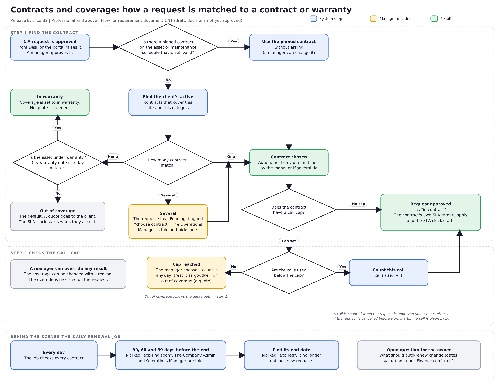

# CNT: Contracts and coverage (requirements)

**Module requirements for Release B, slice B2** | Covers register items CNT-01 to CNT-13 and one proposed item | Based on Blueprint v3.17 | **Draft for developer review. Decisions proposed, waiting for owner approval** | November 12, 2026

Labels in this document use the default words (service request, technician, site). In the product every renamed word goes through the `term()` helper. Money is shown with the decimals of the company's currency.

## 1. Purpose and scope

This module answers one question for every service request: **who pays for this job?** A company records the agreements it has with its customers (annual maintenance contracts, warranties, call-out agreements and defects liability periods). When a request is approved, the system finds the agreement that applies, counts the call against it, applies its SLA targets, and asks a manager only when there is a real choice to make.

In Release A the manager picks the coverage by hand (in contract, in warranty, goodwill or needs a quote) and nothing checks the choice, because there are no contract or asset records. This module replaces that guesswork with a check, and keeps the manager's right to override.

**In scope (13 register items and one proposed)**

- **Contracts:** CNT-01 contract list, CNT-02 contract form.
- **Matching:** CNT-03 coverage matching, CNT-04 choose a contract, CNT-05 pinned default contract.
- **Calls and terms:** CNT-06 call cap, CNT-07 contract SLA overrides.
- **Renewal:** CNT-08 daily renewal job.
- **Messages:** CNT-09 contract.expiring, CNT-10 contract.cap_reached, CNT-13 sr.contract_choice_needed.
- **Developer items:** CNT-11 contracts API, CNT-12 tests.
- **Proposed (D12):** CNT-14 event `contract.renewed`, sent when a contract renews by itself.

**Out of scope for this module**

- Contract profitability (service cost against contract value): Release C.
- The Contract Performance PDF report: slice B8. This module only keeps the data it needs.
- Invoicing the contract fee (the annual value) on a schedule. The Quotes and invoices spec lists contract billing as Release B, but the blueprint's contract rules do not define it. See question Q1 in section 11.
- The asset register, asset warranty dates and the pin field on an asset: slice B1. This module reads them.
- Maintenance schedules and their pinned contract: slice B4. This module defines what a pinned contract means.
- Approval modes (automatic approval if in contract): slice B3. This module says when a request is not ready for automatic approval.

**Needs first:** slice B1 (assets and their warranty dates), and the Release A request lifecycle, SLA engine, quotes, notifications and permissions. **Needed by:** B3 (automatic approval if in contract), B4 (maintenance jobs under a pinned contract), B8 (Contract Performance report).

**Gaps and conflicts found between the existing documents.** Each has a decision below.

1. **Warranty is part of the coverage order.** Blueprint 7.1 gives the order manager override, matched contract, asset under warranty, out of coverage. The first sketch of this module covered contracts only. D4 and D9 include the asset warranty check.
2. **The SLA source order already says contract first.** Blueprint 7.1 puts the contract SLA before the category and company policies, but the Service request spec (SRL) does not mention a contract level. D10 adds it, and the SRL spec must be amended.
3. **The call period has no reset rule.** The schema has `call_period` (contract term, monthly, quarterly, annual) and `calls_used_current_period`, but no text says when the counter resets. D7 defines it.
4. **Contract statuses have no transitions.** The schema lists draft, active, expiring soon, expired, renewed and cancelled. D2 defines how a contract moves between them.
5. **Auto-renew has no meaning yet.** The blueprint has the flag and a renewed-from link, and the owner question "what should auto-renew change" is open. D12 and D13 propose rules.
6. **Two reasons for a manager choice share one flag.** The schema has `contract_choice_pending` for several matching contracts, but a reached call cap also needs a manager choice. D5 and D9 add a reason column.
7. **Call counting has gaps.** The blueprint says a call is counted on approval and released if cancelled before work starts. It does not say what happens on rework, reassignment, a goodwill override, or a count past the cap. D8 defines each.
8. **Matching time.** Blueprint 7.1 says matching contracts are found when the request is created, but calls are counted on approval and a contract may change in between. D3 matches at creation and again at approval.
9. **The client's own contracts.** The permission matrix gives a client user "view own" on `contract.view`, and the Client portal spec lists contracts as Release B. D16 proposes a read-only portal page.
10. **Batch requests.** A batch request covers many assets (slice B3). D4 says the warranty check is skipped for a batch, because assets can differ.
11. **Contract documents.** The first register entry mentions contract documents, but the blueprint field list does not. D15 proposes attaching the signed PDF.
12. **Starter and downgrades.** Contracts are Professional and above. D18 says what happens on a downgrade.

**Where each register item is specified**

| Item | What | Screens | Rules | Tests |
|---|---|---|---|---|
| CNT-01 | Contract list | 5.1 | 6.1 | CC-001 to CC-020 |
| CNT-02 | Contract form | 5.2, 5.3 | 6.1, 6.9 | CC-001 to CC-020 |
| CNT-03 | Coverage matching | 5.4 | 6.2, 6.3 | CC-021 to CC-040 |
| CNT-04 | Choose a contract | 5.5 | 6.4 | CC-041 to CC-052 |
| CNT-05 | Pinned default contract | 5.6 | 6.5 | CC-053 to CC-060 |
| CNT-06 | Call cap | 5.5 | 6.6, 6.7 | CC-061 to CC-076 |
| CNT-07 | Contract SLA overrides | 5.2 | 6.8 | CC-077 to CC-083 |
| CNT-08 | Daily renewal job | | 6.10, 6.11 | CC-084 to CC-095 |
| CNT-09, CNT-10, CNT-13, CNT-14 | The four events | 5.8 | 7 | CC-096 to CC-103 |
| CNT-11 | Contracts API | | 8 | CC-104 to CC-109 |
| CNT-12 | Tests | | 10 | all |
| (all) | Permissions, plan, isolation, client page | 5.7 | 6.12, 6.13 | CC-110 to CC-121 |

## 2. Decisions to review before building

The blueprint and the register did not settle these. Each has my recommendation. Write Approve or your change in the last column. Nothing here is final until you answer. The two decisions the blueprint already lists as open are D12 and D13.

| # | Decision and recommendation | Your answer |
|---|---|---|
| D1 | **What a contract is.** A contract is a recorded agreement between the company and one client, of one of four types: AMC (a recurring maintenance agreement), warranty (work the company does under a warranty it gave or administers), ad-hoc (a call-out or rate agreement with no fixed term of visits) and DLP (a defects liability period after a project). All four are matched the same way. The type is a label for people and reports. **Recommended: approve.** | |
| D2 | **Contract status.** New contracts start as Draft. **Activate** makes a contract Active (it needs a client, type, start and end date). The daily job moves an Active contract to Expiring soon when 90 days or fewer remain, and to Expired the day after its end date. A contract becomes Renewed when a successor is made from it. A manager can Cancel a Draft, Active or Expiring soon contract with a reason. Expired, Renewed and Cancelled contracts never match a new request. A date range, not the status alone, decides matching (D3). **Recommended: approve.** | |
| D3 | **Which contracts match a request.** A contract is a candidate when: it belongs to the request's client, its status is Active or Expiring soon, today (in the company's time zone) is between its start and end dates inclusive, it covers the request's site (no site rows means all the client's sites) and it covers the request's category (no category rows means all categories). Candidates are found when the request is created and again when it is approved, because dates and status can change in between. A candidate found at creation that no longer qualifies at approval is dropped. **Recommended: approve.** | |
| D4 | **The coverage order.** At approval the system suggests coverage in this order: (1) a pinned contract that is still valid, (2) the matching contract, (3) the asset's warranty (the request has a primary asset and its warranty expiry date is today or later), (4) out of coverage. The suggestion fills the coverage and shows its reason. The manager can override it with a reason, and the override, the person and the reason are recorded (`coverage_override_*`). The warranty check is skipped for a batch request. **Recommended: approve.** | |
| D5 | **Several contracts match.** If more than one contract matches and none is pinned and valid, the request stays Pending, `contract_choice_pending` is set with the reason "several", and `sr.contract_choice_needed` goes to the Operations Manager. Someone with `contract.choose` picks one. The choice is audited. The request cannot be approved until a choice is made, and a request cannot be chosen to a contract that does not match it. **Recommended: approve.** | |
| D6 | **A pinned contract.** An asset or a maintenance schedule may name a default contract. A pinned contract is used without asking when it is Active or Expiring soon, in date, and still covers the request's site and category. If it no longer qualifies it is ignored and normal matching runs. A manager may change the contract on the request. **Recommended: approve.** | |
| D7 | **Call cap and periods.** A contract may have a cap (`max_calls`). No cap means unlimited. `call_period` sets what the cap counts over: the whole contract term (never resets), or each month, quarter or year counted from the contract's start date. At the start of each new period a daily job sets the counter to 0 and records the new period start. Calls of earlier periods stay in the call log. **Recommended: approve.** | |
| D8 | **When a call counts and when it is given back.** A call is counted when a request is approved with coverage In contract under that contract. It is given back if the request is cancelled before the first punch in, or if the manager changes the contract or the coverage before the first punch in. It is not given back after work has started, and rework, reassignment and reopening never count a second time. A request that is approved as In warranty, Goodwill or Out of coverage never counts. Every count and give-back is written to a call log. **Recommended: approve.** | |
| D9 | **When the cap is reached.** If an approval finds the cap already reached (calls used is at or above the cap), the request stays Pending with `contract_choice_pending` set and the reason "cap reached", and `contract.cap_reached` goes to the Operations Manager. The manager must choose one of three: **Count it anyway** (the call is counted and the contract goes over its cap, shown in red), **Goodwill** (coverage becomes Goodwill, no billing, with a reason) or **Out of coverage** (the quote path of Release A). The choice needs `contract.choose` and is audited. **Recommended: approve.** | |
| D10 | **Contract SLA targets.** A contract may set a response time and a resolution time in minutes, each optional. When set, they replace the category and company policies for that request, and the order becomes contract, then category and priority policy, then company default (blueprint 7.1). The numbers follow the business-hours setting of the policy that matches the request (category and priority, else the company default), not of the company default alone, so a 24/7 Emergency policy stays 24/7 for contract customers. Targets are final at approval, because the contract can be unknown until then. **Recommended: approve.** | |
| D11 | **The daily renewal job.** Once a day for each company, in this order: move contracts to Expired where the end date has passed, move Active contracts with 90 days or fewer left to Expiring soon, send `contract.expiring` at 90, 60 and 30 days before the end (once for each threshold), apply auto-renew (D12), and roll call periods (D7). Rerunning the job on the same day changes nothing. **Recommended: approve.** | |
| D12 | **Auto-renew (open owner question).** If auto-renew is on, the day after the end date the system creates the next term as a new Active contract: the same client, type, sites, categories, SLA, cap, value and payment terms; start the day after the old end; the same length as the old term; a new number; `renewed_from_contract_id` pointing to the old one. The old contract becomes Renewed. `contract.renewed` goes to the Company Admin and Operations Manager (in-app). A manager can edit or cancel the new contract. Finance does not need to confirm. **Recommended: approve. This is the owner's call, because a wrong renewal creates wrong coverage.** | |
| D13 | **Renewing by hand.** The **Renew** action on an Active, Expiring soon or Expired contract creates a Draft copy with the next term's dates and a new number, ready to edit and activate. When it is activated the old contract becomes Renewed. **Recommended: approve.** | |
| D14 | **Editing a contract.** A Draft can be edited freely or deleted. After activation the client and type cannot change. Dates, SLA, cap, value, terms and the site and category rows can change, and a change only affects requests approved after it. Requests already approved keep their contract and coverage. Every edit is audited with the old and new values. A contract with requests is never deleted, only cancelled. **Recommended: approve.** | |
| D15 | **Contract documents.** The signed contract can be attached as files (PDF or image, up to 10 MB each, up to 5 for each contract) through the existing file mechanism. They are visible to people with `contract.view` and never to technicians. **Recommended: approve.** | |
| D16 | **Who sees what.** Company Admin and Operations Manager manage and choose. Front Desk and Finance can view. Team Lead and Field Technician cannot see contracts. A Client Admin sees a read-only page of their own company's contracts: number, type, dates, covered sites and categories, SLA targets and calls used and remaining. A Client Viewer does not see it. Clients and Front Desk never see the value or the payment terms. **Recommended: approve.** | |
| D17 | **Where the contract shows.** On the request page (number linking to the contract, coverage with its reason, calls used of the cap), on the asset and maintenance schedule where pinned, and in the request list filter and the Excel export. Not in the Field View. In-contract requests never go on an invoice (Quotes and invoices rules), but their expenses stay for cost reporting. **Recommended: approve.** | |
| D18 | **Plans and downgrades.** Contracts are for Professional and above (`contracts`). Starter gets FEATURE_NOT_IN_PLAN. On a downgrade, contracts and call logs are kept and become read-only, matching stops, and new requests go back to the Release A manual coverage choice. Requests already approved keep their coverage. **Recommended: approve.** | |
| D19 | **The events.** `sr.contract_choice_needed` and `contract.cap_reached` go to the Operations Manager by in-app and push with an email fallback. `contract.expiring` goes to the Company Admin and Operations Manager by email and in-app, with no fallback. `contract.renewed` goes to both by in-app. None goes to WhatsApp, so no new WhatsApp template is needed. **Recommended: approve.** | |
| D20 | **Numbers and audit.** Contract numbers come from the company sequence (`tenant_sequences`) with the default pattern CT-YYYY-000001 (prefix CT, blueprint decision D23). Every create, edit, activate, renew, cancel, choose and override writes an audit row. **Recommended: approve.** | |
| D21 | **Maintenance and approval modes.** A request made by a maintenance schedule uses the schedule's pinned contract (slice B4). Automatic approval if in contract (slice B3) applies only when the request has exactly one contract, the cap is not reached and no choice is pending. Otherwise it waits for a manager. **Recommended: approve.** | |
| D22 | **Keeping records.** Contracts and the call log are kept for the life of the company. Contracts are soft deleted only when they are Draft. **Recommended: approve.** | |

**Schema additions (proposed)**

| Item | Change | Why |
|---|---|---|
| SCH-B2-01 | New table `contract_calls`: each time a call is counted or given back, with the request, contract, who and when, and whether it went over the cap | Call counting and give-back (D8), reports |
| SCH-B2-02 | `service_requests`: add `contract_choice_reason ENUM('several','cap_reached') NULL` and `contract_over_cap BOOLEAN NOT NULL DEFAULT FALSE` | The two reasons for a manager choice (D5, D9) |
| SCH-B2-03 | `contracts`: add `activated_at`, `cancelled_at`, `cancel_reason` and `auto_renewed_at` | Status history (D2, D12) |

The existing tables `contracts`, `contract_sites` and `contract_categories`, the columns `service_requests.contract_id`, `contract_choice_pending` and `coverage_type`, and `assets.default_contract_id` are used as they are. Section 4 gives the columns.

**New error codes (proposed)**

| Code | When |
|---|---|
| CONTRACT_CHOICE_REQUIRED | A request is approved while a contract choice is pending |
| CONTRACT_NOT_MATCHING | The chosen contract does not match the request's client, site, category or dates |
| CONTRACT_LOCKED | An edit of a field that cannot change after activation (client, type) |

The blueprint codes FORBIDDEN, FEATURE_NOT_IN_PLAN, VALIDATION_FAILED, NOT_FOUND and INVALID_TRANSITION are used as they are.

## 3. Who can do what

| Action | Permission | Default holders |
|---|---|---|
| See contracts and the call log | contract.view | Company Admin, Operations Manager, Front Desk, Finance. A Client Admin sees their own (D16) |
| Create, edit, activate, renew and cancel a contract | contract.manage | Company Admin, Operations Manager |
| Choose a contract or decide at a reached cap | contract.choose | Company Admin, Operations Manager |
| Approve a request and override coverage | sr.approve | Company Admin, Operations Manager. Team Lead for own team |

Team Lead and Field Technician have no contract permission. These keys are already in the signed permission matrix, so nothing is added.

## 4. Data this module reads and writes

- **Reads:** `contracts`, `contract_sites`, `contract_categories`, `clients`, `project_sites`, `service_categories`, `assets` (warranty expiry date and default contract), `service_requests`, `sr_status_history`, `sla_policies`, `tenant_business_hours`, `tenant_holidays`, `users`, `tenant_settings`.
- **Writes:** `contracts`, `contract_sites`, `contract_categories`, `contract_calls` (new), `service_requests` (contract, coverage, choice flag and reason, over-cap flag, SLA due times), `activity_logs`, `event_outbox` (the four events), `attachments` (documents), `tenant_sequences`.
- **Used by others:** B3 reads the contract and the cap state for automatic approval. B4 reads the pinned contract. B8 reads calls and SLA results for the Contract Performance report. The Quotes and invoices rule that an in-contract job needs no invoice is unchanged.

**Existing table: contracts**

| Column | Type | Rule |
|---|---|---|
| contract_number | VARCHAR(60) | From the company sequence. Unique for each company |
| client_id | BIGINT | One client. Cannot change after activation |
| contract_type | ENUM(amc, warranty, adhoc, dlp) | Cannot change after activation |
| status | ENUM(draft, active, expiring_soon, expired, renewed, cancelled) | Default draft. Moves as in D2 |
| start_date, end_date | DATE | The end date is on or after the start date |
| response_sla_minutes, resolution_sla_minutes | INT NULL | Optional. 1 to 525,600 |
| max_calls | INT NULL | Empty means unlimited. 1 or more |
| call_period | ENUM(contract_term, monthly, quarterly, annual) | Default contract_term |
| calls_used_current_period | INT | Calls counted in the current period. Can pass max_calls only through D9 |
| period_started_on | DATE NULL | Start of the current period |
| annual_value, payment_terms | DECIMAL(14,3) NULL, VARCHAR(120) NULL | Never shown to clients or Front Desk |
| auto_renew | BOOLEAN | Default false (D12) |
| renewed_from_contract_id | BIGINT NULL | The contract this one succeeds |
| notes, deleted_at | TEXT NULL, TIMESTAMP NULL | Soft delete only for Draft (D22) |

**Existing tables.** `contract_sites` (contract, site) and `contract_categories` (contract, category) hold the coverage rows. A pair is unique. No rows means all of the client's sites or all categories.

**Changed table: contracts** (added columns): `activated_at TIMESTAMP NULL`, `cancelled_at TIMESTAMP NULL`, `cancel_reason VARCHAR(255) NULL`, `auto_renewed_at TIMESTAMP NULL`.

**Changed table: service_requests** (added columns): `contract_choice_reason ENUM('several','cap_reached') NULL`, `contract_over_cap BOOLEAN NOT NULL DEFAULT FALSE`. The existing `contract_id`, `contract_choice_pending`, `coverage_type`, `coverage_override_by_user_id` and `coverage_override_reason` are used as they are.

**New table: contract_calls**

| Column | Type | Notes |
|---|---|---|
| contract_id | BIGINT | |
| service_request_id | BIGINT | |
| action | ENUM('counted','given_back') | |
| over_cap | BOOLEAN | True when counted past the cap (D9) |
| period_started_on | DATE | The period the call belongs to |
| user_id | BIGINT NULL | The approver or manager. Empty when the system acts |
| created_at | TIMESTAMP | |

Index on (contract_id, period_started_on) and on (service_request_id).

## 5. Screens

Screens use the standard web layout and work on a phone. Status colours follow the reserved colours and are never the only sign of a state.

### 5.1 Contract list (CNT-01)

Menu: Contracts (Professional and above, with `contract.view`). A table with: number, client, type, status chip, start and end dates, calls used and the cap (for example "5 of 12", red when over), and value (Company Admin, Operations Manager and Finance only). Filters: search by number or client, client, type, status, **ends within 90 days**, and **has a cap**. A **New contract** button for people with `contract.manage`. A row opens the contract.

| State | What is shown |
|---|---|
| No contracts | "No contracts yet." and a New contract button for people who can make one |
| No match | "No contracts match." |
| Downgraded plan | The list is read only with the note "Contracts are not in your plan. Existing contracts are kept." |

### 5.2 Contract form (CNT-02)

Used to create, edit and renew. Sections:

| Section | Fields |
|---|---|
| Contract | Number (assigned on save, shown read only), Client (required), Type (required), Start date and End date (required), Notes |
| Coverage | Sites: choose some of the client's sites, or leave empty for all. Categories: choose some, or leave empty for all. A line states "Covers all of this client's sites" or "Covers 3 sites" |
| Terms | Response time and Resolution time in minutes (optional), Call cap and Call period (optional), Annual value, Payment terms, Auto-renew |
| Documents | Attach the signed contract (D15) |

Buttons: **Save draft**, **Activate** (Draft only), **Renew**, **Cancel contract** (asks for a reason). After activation the Client and Type fields are read only (D14). The form validates before saving, with the messages in section 9.

### 5.3 Contract detail

A header with number, client, type, status and the main dates, then tabs:

- **Details:** the form fields read only, with Edit.
- **Calls:** the current period, calls used and the cap, a bar that turns amber at 80 percent and red when over, and the call log (request, date, counted or given back, by whom, over cap).
- **Requests:** the requests under this contract with status and coverage.
- **Documents:** attached files.
- **History:** the audit trail of this contract.

### 5.4 Coverage on the request page

On the request page of a Pending request the approval area shows the **suggested coverage** with its reason, for example "In contract CT-2026-000012 (AMC). Call 5 of 12.", "In warranty. The asset's warranty ends on 30 Nov 2026." or "Out of coverage. No contract matches and the asset is not under warranty." The manager can accept it or **Change coverage**, which asks for a reason (D4). After approval the request shows the contract number, the coverage and the calls used of the cap.

### 5.5 Choose a contract, and the cap decision (CNT-04, CNT-06)

When a choice is pending, the Pending request shows a banner "Choose a contract before you approve" and the Approve button is disabled.

- **Several contracts (D5).** A dialog lists each matching contract with number, type, end date, calls used of the cap, SLA targets and a short reason it matches. The manager picks one and confirms. A contract that is over its cap is shown with a warning.
- **Cap reached (D9).** A dialog states "Contract CT-2026-000012 has used 12 of 12 calls." with three choices: **Count it anyway**, **Goodwill** (a reason is required) and **Out of coverage** (continues to a quote). Each choice is confirmed.

A list **Needs a contract choice** (Pending requests with the flag) is a filter of the request list, and the Operations queue of the Dashboards spec shows its count as a fourth counter.

### 5.6 Pinning a default contract (CNT-05)

The asset form (slice B1) and the maintenance schedule form (slice B4) have a field **Default contract**, a list of the client's Active and Expiring soon contracts that cover the asset's site. A note says "Used without asking while it is valid and covers the request." If a pinned contract stops being valid, the form shows "The pinned contract is no longer valid."

### 5.7 The client's contracts page (D16)

For a Client Admin of a company on Professional and above: a read-only list of their company's contracts, and a detail page with type, dates, covered sites and categories, SLA targets, and calls used and remaining. No value, no payment terms and no documents.

### 5.8 Notifications

Items in the bell for the four events of section 7, each opening the request or the contract.

## 6. Business rules

The picture shows the whole matching flow. The rules in 6.2 to 6.8 are the detail behind it.

### 6.1 Creating and keeping a contract (CNT-01, CNT-02, D2, D14, D20, D22)

- **Creating.** A contract is saved as a Draft. It needs a client, a type, a start date and an end date. The end date is on or after the start date. The number is taken from the company sequence at save, pattern CT-YYYY-000001 (D20).
- **Activating.** Activate moves a Draft to Active. A contract that starts in the future is Active but only matches from its start date (6.3).
- **Editing.** A Draft can be edited freely or deleted. After activation the client and type are locked (`CONTRACT_LOCKED`). Other fields and the coverage rows can change. A change affects only requests approved after it. Each edit writes an audit row with the old and new values.
- **Cancelling.** A Draft, Active or Expiring soon contract can be cancelled with a reason. A cancelled contract stops matching at once. Requests already approved under it keep their contract and coverage.
- **Deleting.** Only a Draft with no requests can be deleted (soft delete).
- **Documents.** Up to 5 files of 10 MB each (D15).

### 6.2 The coverage order at approval (CNT-03, D4)

When a manager opens a Pending request for approval, or the system approves it, coverage is worked out in this order. The first step that gives an answer wins.

1. **Pinned contract.** The request's asset or maintenance schedule has a pinned contract that is valid (6.5). Use it.
2. **Matching contract.** Find the candidates (6.3). One candidate: use it. Several: a manager must choose (6.4). None: go on.
3. **Asset warranty.** The request has a primary asset and its `warranty_expiry_date` is today or later, in the company's time zone. Coverage is In warranty. A batch request skips this step.
4. **Out of coverage.** The default. The quote path of Release A applies.

The result is shown as a suggestion with its reason (5.4). The manager can override it with a reason (D4). An override is recorded in `coverage_override_by_user_id` and `coverage_override_reason`. A request is never approved while a contract choice is pending (`CONTRACT_CHOICE_REQUIRED`).

### 6.3 Which contracts match (CNT-03, D3)

A contract is a candidate when all of these are true:

- It belongs to the request's client.
- Its status is Active or Expiring soon.
- Today in the company's time zone is on or between its start date and end date.
- It covers the request's site: it has a `contract_sites` row for the site, or it has no site rows.
- It covers the request's category: it has a `contract_categories` row for the category, or it has no category rows.

Candidates are found when the request is created and again at approval. If several candidates exist at creation and none is pinned and valid, the choice flag is set and `sr.contract_choice_needed` is sent at once, so the manager sees it early. At approval the candidates are worked out again: if only one remains the flag is cleared and that contract is used, and if several remain the flag stays. A request with no client, site or category cannot be created (Release A rule), so matching always has these.

### 6.4 Choosing a contract (CNT-04, D5)

- Only a person with `contract.choose` can choose. The chosen contract must be a current candidate, or `CONTRACT_NOT_MATCHING` is returned.
- Choosing sets `contract_id`, clears `contract_choice_pending` and `contract_choice_reason`, and sets coverage In contract. It writes an audit row with the person, the candidates and the choice.
- Choosing a contract does not count a call. The call is counted at approval (6.6).
- If the choice is later wrong, the manager can change the contract before the first punch in, and the call moves (6.6).

### 6.5 A pinned contract (CNT-05, D6)

A pinned contract is valid for a request when it is Active or Expiring soon, today is in its dates, it belongs to the request's client and it covers the request's site and category. A valid pinned contract is used without asking, even when other contracts also match. An invalid pinned contract is ignored and normal matching runs. A pin is never changed by the system.

### 6.6 Counting a call (CNT-06, D7, D8)

- **When.** A call is counted at approval, in the same transaction, when the coverage is In contract. The contract row is locked first, so two approvals at the same moment cannot both take the last call.
- **How.** `calls_used_current_period` goes up by 1. A `contract_calls` row with action counted is written. If the count passes the cap it is marked over cap and `service_requests.contract_over_cap` is set (only through D9).
- **Giving a call back.** If the request is cancelled, or its contract or coverage is changed, before the first punch in, `calls_used_current_period` goes down by 1 (never below 0) and a `given_back` row is written. After the first punch in nothing is given back.
- **No second count.** Rework, reassignment, hold and reopening never count again. A reopened request keeps its contract and its one call.
- **Other coverage.** A request approved In warranty, Goodwill or Out of coverage never counts.
- **Periods.** For a contract with a cap, the period is the whole term, or each month, quarter or year counted from the contract's `start_date`. The daily job (6.10) sets `calls_used_current_period` to 0 and `period_started_on` to the new period's first day when a period ends. A contract with no cap still records calls for reports.

### 6.7 When the cap is reached (CNT-06, D9)

- If the cap is set and `calls_used_current_period` is at or above it when an approval counts a call, the request stays Pending with `contract_choice_pending` set and `contract_choice_reason` cap reached. `contract.cap_reached` goes to the Operations Manager.
- The manager chooses one of three, each with `contract.choose`:
  - **Count it anyway.** The call is counted, marked over cap, and the contract shows red. Coverage is In contract.
  - **Goodwill.** A reason is required. Coverage becomes Goodwill, no billing. The contract stays on the request for reporting, but no call is counted.
  - **Out of coverage.** The contract is cleared from the request and the quote path of Release A starts (send for quote).
- The choice is audited with the person and the reason.
- A request that is over the cap shows "Over the cap" on its page.

### 6.8 The SLA source (CNT-07, D10)

- The order is contract, then category and priority policy, then company default (blueprint 7.1).
- If the contract has a response time, it replaces the response target. If it has a resolution time, it replaces the resolution target. A target the contract does not set comes from the next policy.
- The contract numbers are in minutes and follow the business-hours setting of the policy that matches the request (not the company default alone). A 24/7 Emergency policy stays 24/7 for a contract customer. A contract has no coverage-hours field of its own.
- The SLA clock starts at approval as in Release A. The due times are worked out at approval, after the contract is known. If the contract is changed before approval they are worked out again.
- An Emergency request that starts its clock at creation uses the contract known at that moment. If the contract is chosen later, the due times are recalculated and the clock start does not move.

### 6.9 Status changes (D2, D13)

| From | To | Who or what | Rule |
|---|---|---|---|
| Draft | Active | contract.manage | Needs client, type, dates |
| Active | Expiring soon | Daily job | 90 days or fewer to the end date |
| Active, Expiring soon | Expired | Daily job | The day after the end date |
| Expiring soon | Active | contract.manage or the job | Only if the end date is moved to more than 90 days ahead |
| Active, Expiring soon, Expired | Renewed | Renewing | A successor is activated (D12, D13) |
| Draft, Active, Expiring soon | Cancelled | contract.manage | A reason is required |

Any other change returns `INVALID_TRANSITION`.

### 6.10 The daily job (CNT-08, D11)

Once a day for each company at 02:00 company time, after the nightly usage check, in this order:

1. Move Active or Expiring soon contracts whose end date has passed to Expired.
2. Move Active contracts with 90 days or fewer left to Expiring soon.
3. Send `contract.expiring` for each contract that is exactly 90, 60 or 30 days from its end date, once for each threshold. The dedupe key is the contract and the threshold.
4. Apply auto-renew (6.11).
5. Roll call periods (6.6).

The job is safe to run twice on the same day. It uses the company's time zone for every date.

### 6.11 Renewing (D12, D13)

- **Same length.** If the old term is a whole number of months or years (its end date is the day before an anniversary of its start), the new term has the same number of months or years. Otherwise it has the same number of days.
- **By hand.** Renew creates a Draft copy: new number, start the day after the old end, the same terms, sites, categories, SLA, cap, value and payment terms, calls used 0, `renewed_from_contract_id` set. When it is activated the old contract becomes Renewed.
- **By itself.** If `auto_renew` is on, the job on the day after the end date makes the successor Active at once, sets `auto_renewed_at`, makes the old contract Renewed and sends `contract.renewed`. A manager can edit or cancel it.
- A contract that is already Renewed or has a successor is never renewed again.

### 6.12 Permissions, plans and isolation (D16, D18)

- Every endpoint and screen checks the permission in section 3 on the server.
- Contracts are for Professional and above. Starter gets `FEATURE_NOT_IN_PLAN`.
- On a downgrade, contracts and the call log are kept and become read only, matching stops, and new requests go back to the Release A manual coverage choice. Requests already approved keep their contract and coverage.
- A client user sees only their own company's contracts and only the fields of 5.7.
- Tenant isolation applies to every query. The isolation test suite covers each endpoint.

### 6.13 How other modules use this one (D17, D21)

- **Approval modes (B3).** Automatic approval if in contract applies only when exactly one contract matches, the cap is not reached and no choice is pending.
- **Maintenance (B4).** A maintenance request uses its schedule's pinned contract and follows 6.5.
- **Quotes and invoices.** An In contract request needs no invoice and its expenses never go on an invoice. A request changed to Out of coverage follows the quote path.
- **Service requests.** Cancelling a Pending, Approved or Assigned request before the first punch in gives the call back. Rework and reopening change nothing.
- **Reports (B8).** The Contract Performance report reads `contract_calls`, SLA results and the cap.
- **Dashboards.** The Operations queue shows a counter of requests that need a contract choice.

## 7. Events and wording

The four events use the event engine of the Notifications spec. None is sent by WhatsApp, so no new template is needed.

| Event | Fired by | Recipients and channels | Fallback |
|---|---|---|---|
| sr.contract_choice_needed (CNT-13) | Several contracts match at creation | Operations Manager: in-app, push | Email |
| contract.cap_reached (CNT-10) | An approval finds the cap reached | Operations Manager: in-app, push | Email |
| contract.expiring (CNT-09) | The daily job at 90, 60 and 30 days | Company Admin, Operations Manager: email, in-app | None |
| contract.renewed (CNT-14, proposed) | Auto-renew | Company Admin, Operations Manager: in-app | None |

| Event | Title | Detail |
|---|---|---|
| sr.contract_choice_needed | Choose a contract for {request number} | {client}, {site}. {n} contracts match. Choose the one that applies. |
| contract.cap_reached | Contract {number} has reached its call cap | {client}. {used} of {max} calls used. {request number} needs your decision. |
| contract.expiring | Contract {number} ends in {days} days | {client}. It ends on {date}. Renew it or let it end. |
| contract.renewed | Contract {number} was renewed | {client}. The new contract {new number} runs from {start} to {end}. |

The first two open the request. The last two open the contract. The dedupe key of `contract.expiring` is the contract and the threshold. The others use the request or the contract and the date.

**Audit actions:** contract.created, contract.updated, contract.activated, contract.renewed, contract.auto_renewed, contract.cancelled, contract.deleted, contract.document_added, request.contract_chosen, request.coverage_overridden, contract.call_counted, contract.call_given_back, contract.call_over_cap.

## 8. API

All endpoints are under `/api/v1`. Money is a string with three decimals.

| Method and path | Purpose | Permission |
|---|---|---|
| GET /contracts | List with the filters of 5.1 | contract.view |
| POST /contracts | Create a Draft | contract.manage |
| GET /contracts/{id} | One contract | contract.view |
| PUT /contracts/{id} | Edit (locked fields refused) | contract.manage |
| POST /contracts/{id}/activate | Draft to Active | contract.manage |
| POST /contracts/{id}/renew | Make a Draft successor | contract.manage |
| POST /contracts/{id}/cancel | Cancel with a reason | contract.manage |
| GET /contracts/{id}/calls | Period and the call log | contract.view |
| GET /contracts/{id}/requests | Requests under the contract | contract.view |
| GET /clients/{id}/contracts | A client's usable contracts, for the request form and pins | contract.view |
| GET /service-requests/{id}/coverage | The suggested coverage, the candidates and the reason | sr.approve |
| POST /service-requests/{id}/choose-contract | Choose a contract, or decide at the cap (count anyway, goodwill, out of coverage) | contract.choose |
| GET /portal/contracts | A Client Admin's own contracts (D16) | Client Admin |

**Responses.** 401 UNAUTHENTICATED, 403 FORBIDDEN, 403 FEATURE_NOT_IN_PLAN, 404 NOT_FOUND, 409 INVALID_TRANSITION, 409 CONTRACT_LOCKED, 409 CONTRACT_CHOICE_REQUIRED, 422 VALIDATION_FAILED, 422 CONTRACT_NOT_MATCHING and 429 RATE_LIMITED.

## 9. Exact messages

`{...}` is filled in by the system.

**Contract form**

| Where | Message |
|---|---|
| No client | Choose a client. |
| No type | Choose a type. |
| No start date | Enter a start date. |
| No end date | Enter an end date. |
| End before start | The end date must be on or after the start date. |
| SLA minutes | Enter a whole number of minutes from 1 to 525,600. |
| Cap | Enter a whole number of calls of 1 or more, or leave it empty for no cap. |
| Value | Enter an amount of 0 or more. |
| Cancel reason | Enter a reason of 3 to 255 characters. |
| Locked field | The client and the type cannot be changed after the contract is active. |
| File too big | Files can be up to 10 MB. |
| Too many files | A contract can have up to 5 files. |
| Saved | Contract saved. |
| Activated | Contract activated. |

**Request page and dialogs**

| Where | Message |
|---|---|
| Choice pending | Choose a contract before you approve. |
| Several | {n} contracts match this request. Choose the one that applies. |
| Cap reached | Contract {number} has used {used} of {max} calls. |
| Goodwill reason | Enter a reason of 3 to 255 characters. |
| Not matching | This contract does not cover this request. |
| Over the cap | Over the cap |
| Suggested in contract | In contract {number} ({type}). Call {used} of {max}. |
| Suggested no cap | In contract {number} ({type}). |
| Suggested warranty | In warranty. The asset's warranty ends on {date}. |
| Suggested none | Out of coverage. No contract matches and the asset is not under warranty. |
| Override reason | Enter a reason of 3 to 255 characters. |
| Pin invalid | The pinned contract is no longer valid. |

**Lists**

| Where | Message |
|---|---|
| No contracts | No contracts yet. |
| No match | No contracts match. |
| Read only | Contracts are not in your plan. Existing contracts are kept. |
| Client page empty | There are no contracts to show. |

## 10. Acceptance tests

Each test becomes an automated test. Names in the test files start with the ID. The numbers match the order of the sections.

### 10.1 Contract list and form (CNT-01, CNT-02)

| ID | Scenario | Expected result |
|---|---|---|
| CC-001 | A Company Admin opens Contracts with no contracts | "No contracts yet." and a New contract button |
| CC-002 | Create a contract with no client, no type, no dates | Each field shows its message and nothing is saved |
| CC-003 | An end date before the start date | The end date message is shown |
| CC-004 | Save a valid contract | It is saved as Draft with the next number CT-YYYY-000001 and the audit row contract.created |
| CC-005 | Two contracts saved in the same moment | Each gets a different number |
| CC-006 | Pick three sites and two categories | The coverage line says Covers 3 sites. They are saved in the coverage rows |
| CC-007 | Leave the sites and categories empty | The line says Covers all of this client's sites and the contract matches every site and category |
| CC-008 | Enter SLA minutes of 0 and of 600,000 | Both are refused with the message |
| CC-009 | Enter a cap of 0, of 5 and of empty | 0 is refused. 5 is saved. Empty means no cap |
| CC-010 | Activate a Draft | The status is Active, activated_at is set and contract.activated is audited |
| CC-011 | Edit the client or type of an Active contract | CONTRACT_LOCKED and the message |
| CC-012 | Edit the dates, the cap and the coverage rows of an Active contract | Saved and audited with old and new values. Requests already approved do not change |
| CC-013 | Cancel an Active contract without a reason, then with one | The first is refused. The second sets Cancelled, cancelled_at and the reason |
| CC-014 | Delete a Draft with no requests and an Active contract | The Draft is soft deleted. The Active contract cannot be deleted |
| CC-015 | Attach a 6th file and an 11 MB file | Both are refused with their messages |
| CC-016 | A technician opens a contract address | Not found |
| CC-017 | The list filters | Search, client, type, status, ends within 90 days and has a cap each narrow the list |
| CC-018 | The value column | Shows for Company Admin, Operations Manager and Finance and not for Front Desk |
| CC-019 | The calls column | Shows 5 of 12 and turns red when over the cap |
| CC-020 | The contract detail tabs | Details, Calls, Requests, Documents and History show the right data |

### 10.2 Matching and the coverage order (CNT-03)

| ID | Scenario | Expected result |
|---|---|---|
| CC-021 | A request for a client with one Active contract covering the site and category | The contract is the only candidate and coverage In contract is suggested |
| CC-022 | The same request with the contract in Draft, Expired, Renewed or Cancelled | No candidate |
| CC-023 | A contract with a future start date, and one that ended yesterday | Neither matches today |
| CC-024 | A contract that starts today and one that ends today | Both match, because dates are inclusive |
| CC-025 | A contract that covers other sites only | No candidate |
| CC-026 | A contract with a site row for the request's site | Matches |
| CC-027 | A contract with category rows that do not include the request's category | No candidate |
| CC-028 | An Expiring soon contract in date | Matches |
| CC-029 | A contract of another client | Never matches |
| CC-030 | The company's time zone near midnight | The dates are judged in the company's time zone |
| CC-031 | No candidate and an asset with a warranty date of today | Coverage In warranty with the reason and the date |
| CC-032 | No candidate and an asset with a warranty date of yesterday | Out of coverage |
| CC-033 | No candidate and no asset | Out of coverage |
| CC-034 | A candidate and an asset under warranty | The contract wins |
| CC-035 | A batch request with no contract | The warranty step is skipped and the result is Out of coverage |
| CC-036 | The manager overrides the suggestion with a reason | The override, person and reason are recorded and the new coverage is used |
| CC-037 | The manager overrides without a reason | Refused with the message |
| CC-038 | A contract is cancelled between creation and approval | It is dropped at approval and the request is worked out again |
| CC-039 | A contract the date of which changes between creation and approval | Matching uses the situation at approval |
| CC-040 | Scenario 12 of blueprint 13.3 | Matching, overlaps, pins and the cap behave as listed |

### 10.3 Several contracts and the choice (CNT-04, CNT-13)

| ID | Scenario | Expected result |
|---|---|---|
| CC-041 | Two contracts match and none is pinned | The request stays Pending with the choice flag and reason several. sr.contract_choice_needed goes to the Operations Manager at creation |
| CC-042 | Approve the request with the flag set | CONTRACT_CHOICE_REQUIRED and the Approve button is disabled |
| CC-043 | A person without contract.choose tries to choose | FORBIDDEN |
| CC-044 | Choose one of the candidates | contract_id is set, the flag is cleared, coverage is In contract and the choice is audited |
| CC-045 | Choose a contract that is not a candidate | CONTRACT_NOT_MATCHING |
| CC-046 | Choosing a contract | No call is counted until the approval |
| CC-047 | One of the two contracts expires before approval | At approval one candidate remains, the flag is cleared and that contract is used |
| CC-048 | A third contract is activated before approval | At approval three candidates show and the flag stays |
| CC-049 | The dialog | Lists number, type, end date, calls used of the cap, SLA targets and a reason, and warns about a contract over its cap |
| CC-050 | The request list filter Needs a contract choice | Lists exactly the requests with the flag |
| CC-051 | The Operations queue | Shows the count of requests that need a contract choice |
| CC-052 | Change the chosen contract before the first punch in | The call moves from the first contract to the second with two call log rows |

### 10.4 Pinned contracts (CNT-05)

| ID | Scenario | Expected result |
|---|---|---|
| CC-053 | An asset pins a contract that is valid for the request | It is used without asking even if another contract also matches |
| CC-054 | The pinned contract has expired | It is ignored and normal matching runs |
| CC-055 | The pinned contract does not cover the request's site | It is ignored |
| CC-056 | The pinned contract belongs to another client | It cannot be pinned and is ignored |
| CC-057 | The manager changes the contract on a request with a pin | The change is recorded and allowed |
| CC-058 | The pin field | Lists the client's Active and Expiring soon contracts covering the site |
| CC-059 | A pinned contract that stops being valid | The form shows The pinned contract is no longer valid. |
| CC-060 | A maintenance request with a pinned contract | Follows the same rules (B4) |

### 10.5 Call cap and counting (CNT-06)

| ID | Scenario | Expected result |
|---|---|---|
| CC-061 | Approve an in-contract request under a contract with a cap of 12 and 4 calls used | calls_used_current_period is 5 and a counted row is written |
| CC-062 | A contract with no cap | The call is counted for reports and nothing blocks |
| CC-063 | Two approvals at the same moment for the last call | Only one takes the last call. The other meets the cap |
| CC-064 | Approve a request In warranty, Goodwill or Out of coverage | No call is counted |
| CC-065 | Cancel a request before the first punch in | The call is given back and a given_back row is written |
| CC-066 | Cancel a request after the first punch in | The call is not given back |
| CC-067 | Change the coverage from In contract to Goodwill before the first punch in | The call is given back |
| CC-068 | Rework, reassign, hold and reopen | No second call is counted |
| CC-069 | The counter | Never goes below 0 |
| CC-070 | Approval at a reached cap | The request stays Pending with reason cap reached and contract.cap_reached is sent |
| CC-071 | Count it anyway | The call is counted, marked over cap, the contract shows red and the request shows Over the cap |
| CC-072 | Goodwill with a reason, and without | Coverage becomes Goodwill and no call is counted. Without a reason it is refused |
| CC-073 | Out of coverage at the cap | The contract is cleared and the request goes to the quote path |
| CC-074 | A monthly period | The counter returns to 0 on the first day of the next monthly period counted from the start date, and old calls stay in the log |
| CC-075 | Quarterly, annual and contract term | Each resets as defined. Contract term never resets |
| CC-076 | The Calls tab | Shows the period, the bar (amber at 80 percent, red over) and the log |

### 10.6 Contract SLA targets (CNT-07)

| ID | Scenario | Expected result |
|---|---|---|
| CC-077 | A contract with both SLA times | The request's response and resolution targets come from the contract |
| CC-078 | A contract with only a resolution time | Response comes from the category policy and resolution from the contract |
| CC-079 | A contract with no SLA times | The category and company policies apply |
| CC-080 | The SLA times | Follow the business-hours setting of the policy that matches the request, so a 24/7 Emergency policy stays 24/7 for contract customers |
| CC-081 | The contract is changed before approval | The due times are worked out again |
| CC-082 | An Emergency request whose contract is chosen later | The due times are recalculated and the clock start does not move |
| CC-083 | A request approved under a contract and later contract SLA edited | Already approved requests keep their due times |

### 10.7 The daily job, renewing and expiry (CNT-08)

| ID | Scenario | Expected result |
|---|---|---|
| CC-084 | A contract whose end date was yesterday | The job moves it to Expired |
| CC-085 | An Active contract with 90 days left, and with 91 | Only the first becomes Expiring soon |
| CC-086 | 90, 60 and 30 days before the end | contract.expiring is sent once for each threshold |
| CC-087 | The job runs twice on the same day | Nothing changes and no event is sent twice |
| CC-088 | A company in another time zone | Dates are judged in its own time zone |
| CC-089 | Auto-renew on, a one-year term | On the day after the end a new Active contract is made for the next year with a new number, the old one is Renewed and contract.renewed is sent |
| CC-090 | Auto-renew on, a term that is not whole months | The new term has the same number of days |
| CC-091 | Auto-renew off | The contract becomes Expired and nothing is made |
| CC-092 | A contract that is already Renewed | It is never renewed again |
| CC-093 | Renew by hand | A Draft copy with new dates and calls used 0 is made, and activating it makes the old one Renewed |
| CC-094 | The edited end date of an Expiring soon contract moved past 90 days | It returns to Active |
| CC-095 | A manager edits the auto-renewed contract | The change is allowed and audited |

### 10.8 Events and messages (CNT-09, CNT-10, CNT-13, CNT-14)

| ID | Scenario | Expected result |
|---|---|---|
| CC-096 | sr.contract_choice_needed | In-app and push to the Operations Manager, email if unread, with the wording of section 7 |
| CC-097 | contract.cap_reached | In-app and push to the Operations Manager, email fallback, with the wording |
| CC-098 | contract.expiring | Email and in-app to the Company Admin and Operations Manager, no fallback |
| CC-099 | contract.renewed | In-app to the Company Admin and Operations Manager |
| CC-100 | No WhatsApp message | None of the four events uses WhatsApp |
| CC-101 | A role with no active user | The event goes to the Company Admins |
| CC-102 | Opening an item | Opens the request or the contract |
| CC-103 | Every error and validation message | Matches section 9 word for word |

### 10.9 API (CNT-11)

| ID | Scenario | Expected result |
|---|---|---|
| CC-104 | Every endpoint in section 8 | Works as listed and returns the codes of section 8 |
| CC-105 | GET /clients/{id}/contracts | Returns only usable contracts of that client |
| CC-106 | GET /service-requests/{id}/coverage | Returns the suggestion, the candidates and the reason |
| CC-107 | POST choose-contract with each decision | Count anyway, goodwill and out of coverage each behave as in 6.7 |
| CC-108 | Money in the API | Strings with three decimals |
| CC-109 | A rate limit | RATE_LIMITED returns and recovers |

### 10.10 Permissions, plans, isolation and the client page

| ID | Scenario | Expected result |
|---|---|---|
| CC-110 | Each of the 7 roles against each endpoint and screen | Matches section 3 and the signed matrix |
| CC-111 | Front Desk and Finance | Can view contracts. Front Desk does not see the value or payment terms |
| CC-112 | Team Lead and technician | Cannot see contracts |
| CC-113 | Starter calls any contract endpoint | FEATURE_NOT_IN_PLAN |
| CC-114 | A downgrade to Starter | Contracts are read only, matching stops and new requests use the manual coverage choice. Approved requests keep their coverage |
| CC-115 | An upgrade again | Matching resumes and kept contracts work |
| CC-116 | Company A's token with company B's contract id | Not found on every endpoint |
| CC-117 | A Client Admin opens the contracts page | Sees only their own contracts with the allowed fields and no value, terms or documents |
| CC-118 | A Client Viewer | Does not see the page |
| CC-119 | Another client's contract id | Not found |
| CC-120 | The migrations for the new table and columns | Run forward and back |
| CC-121 | The tenant isolation suite | Covers every endpoint of this module |

## 11. What developers must confirm before building

A developer must answer each of these in writing before the slice starts. The answers are recorded in `docs/decisions.md`, or in the pull request when they are only about how the work is done.

**Questions for the owner**

- **Q1. Invoicing the contract fee.** Does an AMC's annual value get invoiced from this module (for example in instalments), or by Finance by hand as an ordinary invoice? The Quotes and invoices spec lists contract billing as Release B and the blueprint does not define it. This requirement document assumes by hand.
- **Q2. A warning before the cap.** Should the Operations Manager be warned when a contract reaches, say, 80 percent of its calls, not only at the cap? The blueprint has no such event.

**Questions for the developers**

1. **Matching query.** The query and the indexes for the candidates of 6.3, including no-site-rows and no-category-rows, in the company's time zone, and its speed with 10,000 contracts for a company.
2. **Transactions and locks.** How approval counts a call inside one transaction with the contract row locked, and the test that two approvals at the same moment cannot both take the last call.
3. **Matching time.** How creation and approval both run the matching, and how a changed set of candidates clears or sets the choice flag.
4. **Approval screen.** How the suggested coverage and its reason are produced, and how the same code serves the manual approval and the automatic modes of slice B3.
5. **Give-back.** How "before the first punch in" is detected, and the cases of a contract change and a coverage change.
6. **Periods.** How monthly, quarterly and annual periods are counted from the start date, including month ends (a start on the 31st), leap years and the daily roll.
7. **Renewing.** The date arithmetic for "the same number of months or years", and what happens when the old term started on the 31st.
8. **The daily job.** The order of the five steps, the run time, its safety when run twice, and how it works for each company's time zone.
9. **SLA.** How the contract level is added to the SLA source order, how the due times are recalculated after a choice, and the change needed in the SRL spec.
10. **Events.** The dedupe keys, and how `sr.contract_choice_needed` at creation and again at approval do not send twice.
11. **Documents.** Which existing file mechanism is used for contract files and how access is limited to people with `contract.view`.
12. **The client page.** How the allowed fields are built so value, terms and documents can never leak.
13. **Downgrade.** How matching pauses and contracts become read only, and how the plan gate is tested.
14. **Reporting data.** That `contract_calls` and the SLA results hold what the Contract Performance report (B8) needs.
15. **Impact on other specs.** The changes to the SRL spec (contract level of the SLA, matching at creation), the Dashboards spec (the Operations queue counter) and the Client portal spec (the contracts page).

## 12. Review and approval

A developer must confirm they could build this module without asking a question. Anything they would have to ask goes back into this document.

| Item | Name | Date | Answer |
|---|---|---|---|
| Decisions D1 to D22 and the new table, columns and error codes approved or changed | Project owner | | |
| Auto-renew rules (D12, D13), an open owner question, decided | Project owner | | |
| Questions Q1 and Q2 answered | Project owner | | |
| Developer confirms the module can be built without questions, with the answers to section 11 | | | |
| Operations confirms the rules in sections 5 and 6 | | | |
