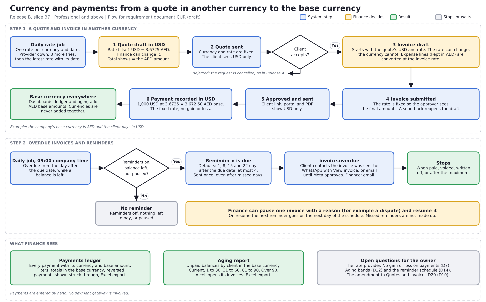

# CUR: Currency and payments (requirements)

**Module requirements for Release B, slice B7** | Covers register items CUR-01 to CUR-07 and LED-01 to LED-07 | Based on Blueprint v3.17 | **Draft for developer review. Decisions proposed, waiting for owner approval** | November 19, 2026

Labels in this document use the default words (service request, quote, invoice, client). In the product every renamed word goes through the `term()` helper. Money is shown with the decimals of its currency.

## 1. Purpose and scope

This module answers two questions for Finance: **what is this job worth in our own money, whatever currency the client pays in**, and **who still owes us, and for how long**. A quote or an invoice may be written in the client's currency with a daily exchange rate that Finance can change. Every payment is recorded in the invoice's currency and also in the company's base currency, so dashboards and reports always add up. Finance sees every payment in one ledger, sees unpaid balances by age, and the system reminds clients about overdue invoices on a schedule the company sets.

In Release A every quote and invoice is in the company's one base currency (Quotes and invoices decision D20), payments are recorded on each invoice only, there is no aging report and no overdue reminder (blueprint 7.7a and decision 33). This module changes the first rule for Professional and above and adds the rest. **No payment gateway is involved.** Payments are still recorded by hand.

**In scope (14 register items)**

- **Currency:** CUR-01 daily exchange rates, CUR-02 currencies and rates page, CUR-03 documents in another currency, CUR-04 payments in the invoice currency, CUR-05 currency in the quote and invoice builders, CUR-06 dashboards in the base currency, CUR-07 tests.
- **Payments and overdue:** LED-01 payments ledger, LED-02 aging report, LED-03 overdue reminders, LED-04 reminder settings, LED-05 the `invoice.overdue` message, LED-06 API, LED-07 tests.

**Out of scope for this module**

- Online payment of invoices by clients through a payment gateway. Not in Phase 1.
- Exchange gains and losses. The rate fixed on the document is used for the payment (D7).
- Changing the company's base currency after its first quote or invoice. It stays locked (blueprint 7.7).
- Accounting sync by webhook: Release C.
- Digests and personal notification preferences for the reminder messages: slice B8.
- Statements of account sent to clients. Not in the register.

**Needs first:** the Release A quotes, invoices and payments (Quotes and invoices spec), the event engine and its WhatsApp templates (Notifications spec), the plan gate, and a running scheduler on the server (Contracts decision sheet, item C2). **Needed by:** B8 (reports in the base currency), B6 (multi-trade billing adds children, in one currency).

**Who owns the code.** Quotes, invoices and payments were built by another developer. This module changes the builders, the record-payment dialog and the dashboards. That developer must review this document before building starts (section 12).

**Sources.** Blueprint v3.17 sections 6, 7.7, 7.7a, 7.9, 9.2, 11.9, 12.2, 13.3 (scenario 17), 14 (decisions 4 and 33) and Appendix C, the Release B scope register and its assumptions 7, 8, 9 and 12, the Release B overview, and the billing tables as they stood on November 19, 2026.

**Gaps and conflicts found between the existing documents.** Each has a decision below.

1. **The Quotes and invoices spec was not available for this draft.** This document changes its decision D20 (one base currency) and builds on its rules for sending, approval and payments. Every decision below must be checked against that spec before approval. Where they differ, the spec wins unless the owner changes it.
2. **A signed Release A rule changes.** QIN D20 keeps every document in the base currency. Multi-currency replaces it on Professional and above. The Release B overview lists this as a risk that needs its own decision (D10).
3. **Payments have no base amount in the code.** Blueprint 11.9 has `payments.base_amount`. The built `payments` table has neither a base amount nor a currency (checked November 19, 2026). SCH-B7-01 adds both.
4. **Field names differ between the blueprint and the code.** Blueprint `invoices.balance_due`, `amount_paid`, `issue_date` and `quote_id`, and `payments.paid_on`, `recorded_by_user_id` and `notes`, are `balance`, (none), `issued_at`, (none), `received_at`, `received_by_user_id` and `note` in the code. This document uses the code's names. The invoice has no `quote_id`, so the rate is carried from the request's accepted quote (D5).
5. **Which currencies a company may use has no table.** CUR-02 says "which currencies a company may quote in". SCH-B7-02 adds one.
6. **The rate provider is not chosen** and there is no rule for when it is down (open action, register CUR-01). D3 sets the fallback. The developers propose the provider.
7. **When an invoice's rate is fixed.** The blueprint fixes a quote's rate when it is sent and carries it to the invoice "unless Finance changes it". It does not say when an invoice that has no quote is fixed. D5 decides.
8. **Expenses stay in the base currency** (blueprint 7.7), but an invoice in another currency is built from them. No rule converts them. D8 decides.
9. **The payment-day rate.** Register assumption 9: no gain or loss, the fixed rate is used. D7 adopts it.
10. **Aging bands.** The blueprint says "30, 60 and 90 days". Register assumption 8 adds Current and Over 90. D12 adopts the assumption.
11. **The reminder schedule is not set.** Register assumption 7 asks for the first reminder day, the gap and when to stop. D14 proposes defaults. The owner decides.
12. **Who gets a reminder.** Blueprint 9.2 says "client contact" and Finance. It does not say which contacts. D15 decides.
13. **The overdue template has no link.** The Appendix C wording of `invoice_overdue` has no button. D16 adds the invoice link as a button, which changes the template before it goes to Meta.
14. **Plans.** Payments and aging sit under `billing_full` and multi-currency under `multi_currency`, both Professional and above (blueprint section 6). D21 says what Starter and a downgrade see.

**Where each register item is specified**

| Item | What | Screens | Rules | Tests |
|---|---|---|---|---|
| CUR-01 | Daily exchange rates | 5.1 | 6.1 | CP-001 to CP-010 |
| CUR-02 | Currencies and rates page | 5.1 | 6.2 | CP-011 to CP-018 |
| CUR-03 | Documents in another currency | 5.2, 5.3 | 6.3, 6.4 | CP-019 to CP-036 |
| CUR-04 | Payments in the invoice currency | 5.4 | 6.5 | CP-037 to CP-044 |
| CUR-05 | Builders with currency | 5.2 | 6.3, 6.6 | CP-019 to CP-036 |
| CUR-06 | Dashboards in the base currency | 5.9 | 6.7 | CP-045 to CP-050 |
| CUR-07 | Currency tests | | 10 | CP-001 to CP-050, scenario 17 |
| LED-01 | Payments ledger | 5.5 | 6.8 | CP-051 to CP-060 |
| LED-02 | Aging report | 5.6 | 6.9 | CP-061 to CP-070 |
| LED-03 | Overdue reminders | 5.8 | 6.10, 6.11 | CP-071 to CP-086 |
| LED-04 | Reminder settings | 5.7 | 6.10 | CP-071 to CP-086 |
| LED-05 | invoice.overdue | | 7 | CP-087 to CP-092 |
| LED-06 | API | | 8 | CP-093 to CP-097 |
| LED-07 | Ledger and reminder tests | | 10 | CP-051 to CP-097 |
| (all) | Permissions, plans, isolation | | 6.12 | CP-098 to CP-108 |

## 2. Decisions to review before building

The blueprint and the register did not settle these. Each has my recommendation. Write Approve or your change in the last column. Nothing here is final until you answer. D7, D10, D12 and D14 are the owner's calls (register assumptions 7, 8 and 9, and the change to a signed Release A rule).

| # | Decision and recommendation | Your answer |
|---|---|---|
| D1 | **Which currencies a company may use.** The base currency is always available. Finance or the Company Admin turns on extra currencies on the Currencies and rates page, from the currencies the rate provider supports. A currency in use on an open document cannot be turned off. **Recommended: approve.** | |
| D2 | **How a rate is written.** A document's `exchange_rate` is the number of base-currency units for one unit of the document's currency ("to base", blueprint 11.9). `base_total` is the total times the rate, rounded half up to the base currency's decimals. A document in the base currency always has rate 1 and no rate field. Rates are stored with 8 decimals and shown with 4 to 6. **Recommended: approve.** | |
| D3 | **Daily rates and when the provider is down** (CUR-01). Once a day the system reads each company's turned-on currencies against its base currency and stores one rate for each pair and date, source provider. If the provider does not answer, the job tries again 3 times during the day. Until a new rate arrives, documents use the most recent stored rate and show its date ("Rate from 17 Nov 2026"). Finance can always type a rate. If no rate is stored at all, the rate field is empty and required. **Recommended: approve. The developers propose the provider and the owner approves it (open action).** | |
| D4 | **The rate on a document** (CUR-03, CUR-05). When Finance picks a currency on a quote or invoice draft, the rate fills from the latest stored rate (D3), source provider. Finance can overwrite it on that document with a number above 0, source manual. Every change of currency or rate is audited with the old and new values. **Recommended: approve.** | |
| D5 | **When the rate is fixed.** A quote's currency and rate are fixed when it is sent (blueprint 7.7). A revision is a new version and may take a new rate. An invoice for a request with an accepted quote starts with that quote's currency and rate. Finance can change the rate while the invoice is a draft, but not its currency. An invoice's currency and rate are fixed when it is submitted for approval, so the approver sees the final amounts. A manager's send-back reopens them with the draft. **Recommended: approve.** | |
| D6 | **The currency of an invoice with no quote.** Finance picks it on the draft from the base currency and the turned-on currencies. It defaults to the base currency. **Recommended: approve.** | |
| D7 | **Payments and the rate (owner, register assumption 9).** A payment is recorded in the invoice's currency (CUR-04). Its base amount is the amount times the invoice's fixed rate. No exchange gain or loss is worked out in Release B. A part payment, a reversal and a write-off follow the same rate. **The owner's call. Recommended: approve.** | |
| D8 | **Expenses on an invoice in another currency.** Technician expenses stay in the base currency (blueprint 7.7). When an approved expense becomes an invoice line, its rate is converted to the invoice's currency at the invoice's rate, rounded half up to that currency's decimals, and Finance can edit the line. If Finance changes the invoice's rate later, the lines are not changed and the builder shows "Lines from expenses were converted at {rate}." **Recommended: approve.** | |
| D9 | **Dashboards and reports in the base currency** (CUR-06). Every money figure on the dashboards, the ledger totals, the aging report and the B8 reports uses `base_total` or `base_amount`. Amounts in different currencies are never added together. Lists show the document's own currency and amount beside the base amount. **Recommended: approve.** | |
| D10 | **The change to the Release A rule (owner).** QIN D20 (every document in the base currency) stays for Starter. On Professional and above it is replaced by D1 to D9. The base currency is still set once and locked after the first quote or invoice (blueprint 7.7). The owner signs this as an amendment to the Quotes and invoices spec. **The owner's call. Recommended: approve.** | |
| D11 | **The payments ledger** (LED-01). One list of every payment on every invoice: payment number, date, client, invoice, amount with its currency, base amount, method, reference, recorded by, and reversed (shown struck through with its reason). Filters: dates, client, method, currency, and include reversed. Totals in the base currency, without reversed payments. Excel export for people with `report.export`, recorded like every export. **Recommended: approve.** | |
| D12 | **The aging report (owner, register assumption 8)** (LED-02). Unpaid balances of sent invoices (sent, part paid or overdue, not void or written off) by client, in bands by days past the due date: Current (not yet due), 1 to 30, 31 to 60, 61 to 90 and Over 90, in the base currency, as of today in the company's time zone. A band opens the list of its invoices. Excel export with `report.export`. **The owner's call. Recommended: approve.** | |
| D13 | **When an invoice is overdue.** Unchanged from Release A: from the day after its due date while it has a balance (blueprint 7.7a). The daily job of 6.11 sets it. **Recommended: approve.** | |
| D14 | **The reminder schedule (owner, register assumption 7)** (LED-04). A company setting, on by default for Professional and above: the first reminder 1 day after the due date, then every 7 days, at most 4 reminders. The Company Admin or Finance can change the three numbers (first day 0 to 30, gap 1 to 30, at most 1 to 10) or turn reminders off. **The owner's call. Recommended: approve.** | |
| D15 | **Who gets a reminder.** The client contacts the invoice was sent to (the recipients on its secure links), and every active Finance user. The client gets WhatsApp when the company's WhatsApp is live and the contact has consented, otherwise email (blueprint 9.2 and 9.7). Finance gets email. **Recommended: approve.** | |
| D16 | **The reminder message** (LED-05). WhatsApp uses the Appendix C wording of `invoice_overdue` with a **View invoice** button to the invoice's secure link, like `invoice_sent`. The button changes the template before it goes to Meta. The template becomes mandatory for Professional and above (register assumption 12). Until Meta approves it, reminders go by email. **Recommended: approve.** | |
| D17 | **Stopping and pausing reminders.** Reminders stop when the invoice is paid, voided or written off, or the maximum is reached. Finance can pause reminders on one invoice with a reason (for example a dispute) and resume them. A pause is audited. **Recommended: approve.** | |
| D18 | **The daily overdue job** (LED-03). Once a day for each company at 09:00 company time: mark invoices overdue (D13), then send the reminders that are due (D14). A reminder is sent at most once for each invoice and reminder number, so running the job twice changes nothing. A day the job missed is caught up with one reminder, never several. **Recommended: approve.** | |
| D19 | **The currencies and rates page** (CUR-02). Turned-on currencies, the rate history of each (date, rate, source) and a manual rate for a date, which replaces the provider rate for that date. A manual rate is audited. **Recommended: approve.** | |
| D20 | **Who can do what.** No new permission keys. The currencies page and reminder settings need `settings.manage` or `invoice.manage`. Changing a rate on a document needs `quote.manage` or `invoice.manage`. The ledger and the aging report need `payment.record`, `invoice.manage` or `invoice.approve`. Export needs `report.export`. **Recommended: approve.** | |
| D21 | **Plans and downgrades.** Multi-currency needs `multi_currency`, and the ledger, aging and reminders need `billing_full`, both Professional and above (blueprint section 6). Starter gets FEATURE_NOT_IN_PLAN and keeps the base currency. On a downgrade, documents already in another currency stay as they are and can still be paid, new documents use the base currency, the ledger and aging become unavailable and reminders stop. **Recommended: approve.** | |
| D22 | **Rounding.** Every step rounds half up to the decimals of its currency (blueprint 7.7a), for example 2 for AED, INR and USD, 3 for KWD, BHD and OMR, and 0 for JPY. Stored with three decimals. **Recommended: approve.** | |

**Schema additions (proposed)**

| Item | Change | Why |
|---|---|---|
| SCH-B7-01 | `payments`: add `currency_code CHAR(3)` and `base_amount DECIMAL(14,3)`, filled for existing rows from their invoice | The ledger and base totals (D7, D9). Blueprint 11.9 already has `base_amount` |
| SCH-B7-02 | New table `tenant_currencies`: `tenant_id`, `currency_code`, `is_active`, `created_by_user_id`, timestamps. The pair company and currency is unique | Which currencies a company may use (D1) |
| SCH-B7-03 | `tenant_settings`: add `overdue_reminders_enabled BOOLEAN DEFAULT TRUE`, `overdue_first_after_days SMALLINT DEFAULT 1`, `overdue_repeat_days SMALLINT DEFAULT 7`, `overdue_max_reminders SMALLINT DEFAULT 4` | The reminder schedule (D14) |
| SCH-B7-04 | `invoices`: add `reminder_count SMALLINT DEFAULT 0`, `last_reminder_at TIMESTAMP NULL`, `reminders_paused_at TIMESTAMP NULL`, `reminders_paused_reason VARCHAR(255) NULL` | Sending once, stopping and pausing (D17, D18) |

The existing `exchange_rates` table and the `currency_code`, `exchange_rate`, `rate_source` and `base_total` columns on `quotes` and `invoices` are used as they are. Each reminder is also written to `invoice_events` with the type `reminder_sent`.

**New error codes (proposed)**

| Code | When |
|---|---|
| CURRENCY_NOT_ENABLED | A document uses a currency the company has not turned on |
| RATE_LOCKED | A change to the currency or rate of a sent quote or a submitted invoice |
| CURRENCY_IN_USE | Turning off a currency that an open document uses |

The blueprint codes FORBIDDEN, FEATURE_NOT_IN_PLAN, VALIDATION_FAILED, NOT_FOUND and INVALID_TRANSITION are used as they are.

## 3. Who can do what

| Action | Permission | Default holders |
|---|---|---|
| Turn currencies on and off, add a manual rate, change reminder settings | settings.manage or invoice.manage | Company Admin, Finance |
| Pick a currency and change the rate on a quote or invoice draft | quote.manage or invoice.manage | Company Admin, Finance |
| Record and reverse a payment (in the invoice currency) | payment.record | Company Admin, Finance |
| See the payments ledger and the aging report | payment.record, invoice.manage or invoice.approve | Company Admin, Finance, Operations Manager |
| Export the ledger and the aging report | report.export | As the signed matrix gives it |
| Pause and resume reminders on an invoice | invoice.manage | Company Admin, Finance |

These keys are already in the signed permission matrix, so nothing is added. A client sees only their own documents, always in the document's own currency.

## 4. Data this module reads and writes

- **Reads:** `tenants` (base currency, time zone, plan), `tenant_currencies`, `exchange_rates`, `quotes`, `quote_items`, `invoices`, `invoice_items`, `invoice_tokens` (the recipients), `payments`, `service_request_expenses`, `clients`, `client_contacts`, `users` and `roles` (Finance), `tenant_settings`.
- **Writes:** `exchange_rates`, `tenant_currencies`, `quotes` and `invoices` (currency, rate, rate source, base total, reminder columns, overdue status), `payments` (currency, base amount), `invoice_events`, `event_outbox` (`invoice.overdue`), `activity_logs`.
- **Used by others:** dashboards and the B8 reports read `base_total` and `base_amount`. B6 bills children on one invoice in one currency.

**Changed table: payments** (added columns)

| Column | Type | Rule |
|---|---|---|
| currency_code | CHAR(3) | Always the invoice's currency |
| base_amount | DECIMAL(14,3) | Amount times the invoice's fixed rate, rounded half up to the base currency's decimals (D7) |

**Existing table: exchange_rates**

| Column | Type | Rule |
|---|---|---|
| from_currency, to_currency | CHAR(3) | The document currency and the base currency |
| rate | DECIMAL(18,8) | Base units for one unit (D2). Above 0 |
| rate_date | DATE | In the company's time zone |
| source | ENUM(provider, manual) | A manual rate replaces the provider rate for that date (D19) |

One row for each company, pair and date (unique key in blueprint 11.9).

**New table: tenant_currencies**

| Column | Type | Notes |
|---|---|---|
| tenant_id | BIGINT | |
| currency_code | CHAR(3) | ISO 4217, supported by the provider. Never the base currency |
| is_active | BOOLEAN | Turned off keeps history |
| created_by_user_id | BIGINT | |

## 5. Screens

Screens use the standard web layout and work on a phone. Status colours follow the reserved colours and are never the only sign of a state.

### 5.1 Currencies and rates (CUR-02)

In company settings, Professional and above. The base currency at the top, marked "Base currency, locked". A list of turned-on currencies with today's rate, its date and source, and Turn off. An **Add currency** button. A currency opens its rate history (date, rate, source) with **Add a rate for a date**.

| State | What is shown |
|---|---|
| No extra currencies | "Only {base} is turned on. Add a currency to quote and invoice in it." |
| No rate today | The latest rate with "Rate from {date}" |
| Starter | "Other currencies are not in your plan." |

### 5.2 Quote and invoice builders (CUR-05)

A **Currency** list next to the client: the base currency and the turned-on currencies. When it is not the base currency, a rate line shows "1 {currency} = {rate} {base} · from provider, {date}" with **Change rate**, and the totals show "{total} {currency} ≈ {base total} {base}". Lines from expenses show the note of D8 when the rate changed after they were added. On a sent quote and a submitted invoice the currency and rate are read only.

### 5.3 Quote and invoice pages and PDFs

The document's currency and amounts. The office page also shows the rate, its source and the base total. The client's link, portal page and PDF show the document's currency only, never the rate or the base amount.

### 5.4 Record a payment (CUR-04)

The dialog of Release A with the amount in the invoice's currency ("Amount in {currency}") and a line under it: "≈ {base amount} {base} at the invoice rate {rate}." The invoice's balance stays in its own currency.

### 5.5 Payments ledger (LED-01)

Menu: Finance, Payments. A table with: payment number, date, client, invoice, amount and currency, base amount, method, reference, recorded by, and a Reversed chip. Filters: dates (This month by default), client, method, currency, include reversed. A total line in the base currency. **Export** for people with `report.export`. A row opens the invoice.

| State | What is shown |
|---|---|
| No payments | "No payments recorded yet." |
| No match | "No payments match." |

### 5.6 Aging report (LED-02)

Menu: Finance, Aging. One row for each client with an unpaid balance and the columns Current, 1 to 30, 31 to 60, 61 to 90, Over 90 and Total, in the base currency, with a total row. A cell opens the invoices behind it (number, due date, days overdue, balance in its own currency and in the base currency). Filter by client. **Export**. "As of {today}".

| State | What is shown |
|---|---|
| Nothing unpaid | "No unpaid invoices." |

### 5.7 Reminder settings (LED-04)

In company settings, Billing. **Send overdue reminders** on or off, **First reminder** "{n} days after the due date", **Then every** "{n} days", **At most** "{n} reminders", and a line explaining who receives them (D15). Save.

### 5.8 Reminders on the invoice page (LED-03)

A Reminders line on an overdue invoice: "{count} of {max} reminders sent. Last on {date}." with **Pause reminders** (asks for a reason) or **Resume reminders**. The invoice's history lists each reminder.

### 5.9 Dashboards (CUR-06)

The Finance dashboard and every money figure show the base currency. A figure that includes documents in other currencies shows the note "Converted at each document's rate."

## 6. Business rules

The picture shows how money moves from a quote in another currency to the base currency, and how overdue reminders run. The rules in 6.1 to 6.12 are the detail behind it.

### 6.1 Daily rates (CUR-01, D3)

- Once a day, for each company with turned-on currencies, the job reads the rate of each currency against the base currency and stores it for that date in the company's time zone, source provider.
- A manual rate for the same date is never overwritten (D19).
- If the provider fails, the job tries again 3 times during the day. The most recent stored rate stays in use and shows its date.
- A company with no turned-on currencies is skipped.

### 6.2 Currencies (CUR-02, D1, D19)

- The base currency cannot be added, turned off or changed here.
- A currency can be turned off only when no draft, sent or part-paid document uses it (`CURRENCY_IN_USE`). Turned-off currencies keep their rate history.
- A manual rate needs a date (today or earlier) and a rate above 0. It replaces the provider rate for that date and is audited.

### 6.3 A document in another currency (CUR-03, CUR-05, D2, D4, D6)

- Picking a currency fills the rate from the latest stored rate (6.1). The base currency always has rate 1.
- Finance can overwrite the rate (`rate_source` manual). The change is audited.
- `base_total` is worked out again whenever the total or the rate changes.
- A currency that is not turned on is refused (`CURRENCY_NOT_ENABLED`).
- Arithmetic follows blueprint 7.7a in the document's currency and D22's rounding.

### 6.4 When the rate is fixed (D5)

| Document and moment | Currency | Rate |
|---|---|---|
| Quote draft | Can change | Can change |
| Quote sent | Fixed | Fixed (`RATE_LOCKED`) |
| Quote revision | Copied from the old version, can change | Fills again from today's rate, can change |
| Invoice draft for a request with an accepted quote | The quote's, fixed | Starts with the quote's, can change |
| Invoice draft with no quote | Can change (D6) | Can change |
| Invoice submitted, approved, sent, paid | Fixed | Fixed (`RATE_LOCKED`) |
| Invoice sent back to draft | Back to the draft rules | Back to the draft rules |

### 6.5 Payments (CUR-04, D7)

- The amount is in the invoice's currency. `currency_code` is the invoice's and `base_amount` is the amount times the invoice's rate.
- Part payments, the balance, overdue and write-off follow Release A in the invoice's currency.
- A reversal keeps its base amount, so the ledger shows it struck through and leaves it out of the totals.
- Existing payments get `currency_code` and `base_amount` from their invoice when the migration runs.

### 6.6 Expenses on an invoice (D8)

- An approved expense line is converted from the base currency at the invoice's rate when it is added: rate in invoice currency = expense rate divided by the invoice rate, rounded half up.
- A later change of the invoice's rate does not change these lines. The builder shows the note of D8.
- In the base currency nothing is converted.

### 6.7 Dashboards and reports (CUR-06, D9)

- Money figures add `base_total` (quotes, invoices) and `base_amount` (payments). Release A documents already have base totals at rate 1.
- Lists show both amounts. Clients never see a rate or a base amount.

### 6.8 The payments ledger (LED-01, D11)

- Every payment of the company, newest first, with the filters of 5.5.
- Totals use `base_amount` and leave out reversed payments.
- The export has the same columns and filters, up to 5,000 rows, and is recorded like the request export (blueprint 7.9a).

### 6.9 The aging report (LED-02, D12)

- An invoice counts when its status is sent, part paid or overdue and its balance is above 0. Void and written-off invoices never count.
- Days past due = today minus the due date, in the company's time zone. Current is 0 or fewer days. Then 1 to 30, 31 to 60, 61 to 90 and Over 90.
- Each balance is converted at the invoice's rate. The totals are in the base currency.
- An invoice with no due date counts as Current.

### 6.10 The reminder schedule (LED-03, LED-04, D14, D15, D17)

- Reminder number n is due on: due date + first-reminder days + (n − 1) × gap, for n from 1 to the maximum.
- A reminder is sent only when the invoice is overdue, has a balance, is not paused, reminders are on for the company, and the plan has `billing_full`.
- It goes to the client contacts the invoice was sent to (6.11) and to every active Finance user.
- A pause stops the schedule. On resume, the next reminder number goes on the next day of the schedule after today, and the gap applies from there. Reminders not sent during the pause are not made up. The maximum still counts only reminders sent.
- A change to the settings applies from the next day's run.

### 6.11 The daily overdue job (D13, D18)

Once a day for each company at 09:00 company time:

1. Mark sent and part-paid invoices overdue from the day after their due date.
2. Send each reminder that is due today, or was due on a missed day, once: raise `invoice.overdue`, add 1 to `reminder_count`, set `last_reminder_at`, write an `invoice_events` row. If several were missed, send one.

The dedupe key is the invoice and the reminder number. The job is safe to run twice.

### 6.12 Permissions, plans and isolation (D20, D21)

- Every endpoint and screen checks the permission of section 3 on the server.
- Starter gets `FEATURE_NOT_IN_PLAN` for currencies, the ledger, aging and reminder settings.
- After a downgrade, documents in other currencies keep their currency and rate and can be paid. New documents use the base currency.
- A client sees only their own documents. Tenant isolation applies to every query, including rates.

## 7. Events and wording

One event, from the event engine of the Notifications spec.

| Event | Fired by | Recipients and channels | Fallback |
|---|---|---|---|
| invoice.overdue (LED-05) | The daily job, for each reminder (6.11) | Client contacts the invoice was sent to: WhatsApp. Finance: email | Email |

| Channel | Wording |
|---|---|
| WhatsApp (`invoice_overdue`) | Invoice {{1}} was due on {{2}} and is still unpaid. Please arrange payment or contact us. Button: View invoice. |
| Email to the client: subject | Invoice {invoice number} is overdue |
| Email to the client: body | Invoice {invoice number} for {amount} was due on {due date} and is still unpaid. Please arrange payment or contact us. View invoice: {link} |
| Email to Finance: subject | Reminder {n} sent for invoice {invoice number} |
| Email to Finance: body | {client}. {balance} unpaid, {days} days overdue. Reminder {n} of {max} was sent to {recipients}. |

The dedupe key is the invoice and the reminder number. `payment.received` stays as in Release A.

**Audit actions:** currency.enabled, currency.disabled, rate.manual_added, quote.rate_changed, invoice.rate_changed, invoice.reminders_paused, invoice.reminders_resumed, invoice.reminder_sent, settings.reminders_changed, ledger.exported, aging.exported.

## 8. API

All endpoints are under `/api/v1`. Money is a string with three decimals and comes with its currency code. Rates are strings with 8 decimals.

| Method and path | Purpose | Permission |
|---|---|---|
| GET /master-data/currencies | Base and turned-on currencies with today's rate | settings.manage, invoice.manage, quote.manage |
| POST /master-data/currencies | Turn a currency on | settings.manage or invoice.manage |
| DELETE /master-data/currencies/{code} | Turn it off (refused when in use) | settings.manage or invoice.manage |
| GET /master-data/rates?currency= | Rate history | settings.manage, invoice.manage, quote.manage |
| POST /master-data/rates | A manual rate for a date | settings.manage or invoice.manage |
| GET /master-data/rates/latest?currency= | The rate a new document gets | quote.manage or invoice.manage |
| PUT /quotes/{id}, PUT /invoices/{id} | Currency and rate, with the rules of 6.4 | quote.manage, invoice.manage |
| GET /payments | The ledger with the filters of 5.5 | payment.record, invoice.manage, invoice.approve |
| GET /payments/export | Excel export | report.export |
| GET /reports/aging | The aging report | payment.record, invoice.manage, invoice.approve |
| GET /reports/aging/export | Excel export | report.export |
| GET /settings/reminders, PUT /settings/reminders | Reminder settings | settings.manage or invoice.manage |
| POST /invoices/{id}/reminders/pause, /resume | Pause with a reason, or resume | invoice.manage |

**Responses.** 401 UNAUTHENTICATED, 403 FORBIDDEN, 403 FEATURE_NOT_IN_PLAN, 404 NOT_FOUND, 409 RATE_LOCKED, 409 CURRENCY_IN_USE, 409 INVALID_TRANSITION, 422 VALIDATION_FAILED, 422 CURRENCY_NOT_ENABLED and 429 RATE_LIMITED.

## 9. Exact messages

`{...}` is filled in by the system.

**Currencies and rates**

| Where | Message |
|---|---|
| Only base | Only {base} is turned on. Add a currency to quote and invoice in it. |
| Base line | Base currency, locked |
| Old rate | Rate from {date} |
| In use | {currency} is used on open documents and cannot be turned off. |
| Rate value | Enter a rate above 0. |
| Rate date | Choose today or an earlier date. |
| Rate added | Rate saved. |
| Starter | Other currencies are not in your plan. |

**Builders and documents**

| Where | Message |
|---|---|
| Rate line | 1 {currency} = {rate} {base} · from provider, {date} |
| Manual rate line | 1 {currency} = {rate} {base} · entered by hand |
| No rate stored | Enter the rate for {currency}. |
| Base total | ≈ {base total} {base} |
| Locked | The currency and rate cannot be changed after the quote is sent or the invoice is submitted. |
| Not turned on | {currency} is not turned on for your company. |
| Expense note | Lines from expenses were converted at {rate}. |
| Payment line | ≈ {base amount} {base} at the invoice rate {rate}. |

**Ledger, aging and reminders**

| Where | Message |
|---|---|
| No payments | No payments recorded yet. |
| No match | No payments match. |
| Nothing unpaid | No unpaid invoices. |
| Converted note | Converted at each document's rate. |
| Reminders line | {count} of {max} reminders sent. Last on {date}. |
| Pause reason | Enter a reason of 3 to 255 characters. |
| Paused | Reminders paused. |
| Resumed | Reminders resumed. |
| Settings numbers | Enter a whole number from {min} to {max}. |
| Settings saved | Reminder settings saved. |

## 10. Acceptance tests

Each test becomes an automated test. Names in the test files start with the ID. CP-019 to CP-044 together cover scenario 17 of blueprint 13.3.

### 10.1 Daily rates (CUR-01)

| ID | Scenario | Expected result |
|---|---|---|
| CP-001 | A company with base AED and USD turned on | The job stores one USD to AED rate for today, source provider |
| CP-002 | The job runs twice the same day | One row |
| CP-003 | A manual rate exists for today | The provider rate does not replace it |
| CP-004 | The provider fails all day | The latest stored rate stays in use and shows its date |
| CP-005 | No rate stored at all | The rate field is empty and required |
| CP-006 | A company with no turned-on currencies | Skipped |
| CP-007 | The company's time zone near midnight | The rate date is the company's date |
| CP-008 | Two companies with the same pair | Each has its own row |
| CP-009 | A rate of 0 or below from the provider | Not stored |
| CP-010 | Rates stored | With 8 decimals |

### 10.2 Currencies page (CUR-02)

| ID | Scenario | Expected result |
|---|---|---|
| CP-011 | Turn on USD | It appears with its rate |
| CP-012 | Try to turn on the base currency | Refused |
| CP-013 | Turn off USD used on a sent invoice | CURRENCY_IN_USE |
| CP-014 | Turn off USD with no open document | Turned off, history kept |
| CP-015 | Add a manual rate for yesterday | Saved, replaces the provider rate for that date, audited |
| CP-016 | A manual rate of 0, and for tomorrow | Both refused with their messages |
| CP-017 | Starter opens the page | FEATURE_NOT_IN_PLAN |
| CP-018 | A Front Desk user | Not found |

### 10.3 Documents in another currency (CUR-03, CUR-05)

| ID | Scenario | Expected result |
|---|---|---|
| CP-019 | A quote draft in USD for an AED company | The rate fills from today's USD to AED rate, source provider |
| CP-020 | Finance overwrites the rate | Source manual, audited, base total worked out again |
| CP-021 | A rate of 0 | Refused |
| CP-022 | A quote in EUR that is not turned on | CURRENCY_NOT_ENABLED |
| CP-023 | Totals | In USD with "≈ base total AED" |
| CP-024 | Send the quote | Currency and rate fixed. A later change returns RATE_LOCKED |
| CP-025 | Revise a sent quote | The new version can take a new rate |
| CP-026 | The client's link, portal and PDF | Show USD amounts, no rate and no base amount |
| CP-027 | Accept the quote, build the invoice | The invoice starts in USD with the quote's rate |
| CP-028 | Change the invoice's currency | Refused while it has an accepted quote |
| CP-029 | Change the invoice's rate as a draft | Allowed and audited |
| CP-030 | Submit the invoice | Currency and rate fixed |
| CP-031 | A manager sends it back | The draft rules apply again |
| CP-032 | An invoice with no quote | Currency chosen, base currency by default |
| CP-033 | An expense of 100 AED on a USD invoice at rate 3.6725 | The line is 27.23 USD, editable |
| CP-034 | The invoice's rate changes after that | The line stays and the note shows |
| CP-035 | A base-currency document | Rate 1, no rate field |
| CP-036 | KWD and JPY documents | Rounded to 3 and 0 decimals |

### 10.4 Payments in the invoice currency (CUR-04)

| ID | Scenario | Expected result |
|---|---|---|
| CP-037 | Record 1,000 USD on a USD invoice at 3.6725 | Amount 1,000 USD, base amount 3,672.50 AED |
| CP-038 | A part payment | Balance in USD, base amount at the same rate |
| CP-039 | A payment on a day with a different rate | The invoice's fixed rate is used |
| CP-040 | Reverse a payment | Base amount kept, left out of the totals |
| CP-041 | Write off the balance | In USD at the fixed rate |
| CP-042 | The dialog | Shows the base line |
| CP-043 | The migration on Release A payments | Each gets the invoice's currency and base amount |
| CP-044 | Overdue on a USD invoice | Starts the day after its due date as in Release A |

### 10.5 Dashboards (CUR-06)

| ID | Scenario | Expected result |
|---|---|---|
| CP-045 | The Finance dashboard with AED and USD invoices | All money in AED from base totals |
| CP-046 | Unpaid and overdue totals | Converted at each invoice's rate |
| CP-047 | The converted note | Shows when other currencies are included |
| CP-048 | Amounts in different currencies | Never added together |
| CP-049 | Release A documents | Counted at rate 1 |
| CP-050 | Scenario 17 end to end | Rate filled and overridable, fixed when sent, carried to the invoice, payment in USD, dashboards in AED |

### 10.6 Payments ledger (LED-01)

| ID | Scenario | Expected result |
|---|---|---|
| CP-051 | Open the ledger | This month's payments, newest first |
| CP-052 | Each filter | Dates, client, method, currency and include reversed narrow the list |
| CP-053 | The total line | In AED from base amounts, without reversed payments |
| CP-054 | A reversed payment | Struck through with its reason, shown only with the filter |
| CP-055 | No payments | No payments recorded yet. |
| CP-056 | Export | Same columns and filters, recorded |
| CP-057 | Export without report.export | Refused |
| CP-058 | An Operations Manager | Sees the ledger, cannot record a payment |
| CP-059 | A row | Opens the invoice |
| CP-060 | An export over 5,000 rows | Refused with the Release A export message |

### 10.7 Aging report (LED-02)

| ID | Scenario | Expected result |
|---|---|---|
| CP-061 | Invoices not yet due, 10, 45, 75 and 120 days past due | One in each band |
| CP-062 | Exactly 30, 60 and 90 days | In 1 to 30, 31 to 60 and 61 to 90 |
| CP-063 | A paid, a void and a written-off invoice | Not counted |
| CP-064 | A part-paid invoice | Its balance counts |
| CP-065 | A USD invoice | Its balance converted at its rate |
| CP-066 | The total row | Adds the bands |
| CP-067 | A cell | Opens its invoices with both amounts |
| CP-068 | The company's time zone | Days counted in it |
| CP-069 | Nothing unpaid | No unpaid invoices. |
| CP-070 | Export | Same figures, recorded |

### 10.8 Reminders and settings (LED-03, LED-04)

| ID | Scenario | Expected result |
|---|---|---|
| CP-071 | Defaults on a new Professional company | On, first 1 day after, every 7 days, at most 4 |
| CP-072 | An invoice due on the 1st | Reminders on the 2nd, 9th, 16th and 23rd, then none |
| CP-073 | Paid on the 10th | No reminder after it |
| CP-074 | Voided or written off | Reminders stop |
| CP-075 | Pause with a reason, then resume on the 20th | No reminder while paused. The next goes on the 23rd |
| CP-076 | Pause without a reason | Refused |
| CP-077 | Reminders turned off | None sent |
| CP-078 | The settings numbers out of range | Refused with the message |
| CP-079 | A settings change | Applies from the next day's run |
| CP-080 | The job runs twice the same day | Each reminder sent once |
| CP-081 | The job missed three days | One reminder sent, not three |
| CP-082 | The invoice page | Shows the count, the last date and Pause |
| CP-083 | The invoice history | Lists each reminder |
| CP-084 | A Starter company | No reminders and no settings |
| CP-085 | A company in another time zone | The job runs at 09:00 there |
| CP-086 | An invoice with no balance | Never reminded |

### 10.9 The overdue message (LED-05)

| ID | Scenario | Expected result |
|---|---|---|
| CP-087 | WhatsApp live and consent given | The contact gets invoice_overdue with the View invoice button |
| CP-088 | WhatsApp not live, or no consent | The contact gets the email |
| CP-089 | The template not yet approved by Meta | Email |
| CP-090 | Finance | Gets the Finance email for each reminder |
| CP-091 | Only the contacts the invoice was sent to | Get it |
| CP-092 | Every message | Matches section 7 and section 9 word for word |

### 10.10 API (LED-06)

| ID | Scenario | Expected result |
|---|---|---|
| CP-093 | Every endpoint in section 8 | Works as listed and returns its codes |
| CP-094 | Money in the API | Strings with three decimals and a currency code |
| CP-095 | Rates in the API | Strings with 8 decimals |
| CP-096 | GET /master-data/rates/latest | Returns the rate a new document would get, with its date and source |
| CP-097 | A rate limit | RATE_LIMITED returns and recovers |

### 10.11 Permissions, plans and isolation

| ID | Scenario | Expected result |
|---|---|---|
| CP-098 | Each of the 7 roles against each endpoint and screen | Matches section 3 and the signed matrix |
| CP-099 | Finance | Turns currencies on, changes rates, records payments, sees the ledger and aging |
| CP-100 | Operations Manager | Sees the ledger and aging only |
| CP-101 | Technician and Front Desk | Not found |
| CP-102 | Starter on any endpoint of this module | FEATURE_NOT_IN_PLAN |
| CP-103 | A downgrade with open USD invoices | They keep USD and can be paid. New documents are in AED. Reminders stop |
| CP-104 | Company A's token with company B's ids | Not found on every endpoint |
| CP-105 | A client user | Sees only their own documents in their own currency |
| CP-106 | The migrations | Run forward and back, and fill existing payments |
| CP-107 | The tenant isolation suite | Covers every endpoint of this module |
| CP-108 | The audit actions of section 7 | Each is written |

## 11. What developers must confirm before building

A developer must answer each of these in writing before the slice starts. The answers are recorded in `docs/decisions.md`, or in the pull request when they are only about how the work is done.

**Questions for the owner**

- **Q1. The rate provider.** Which daily rates provider to use, its cost and its key (open action). The developers propose.
- **Q2. Gains and losses.** Approve that no exchange gain or loss is worked out in Release B (D7), or ask for it.
- **Q3. Aging bands and the reminder schedule.** Approve D12 and D14, or change the numbers.
- **Q4. The Quotes and invoices spec.** Where it is, so this document can be checked against it, and the amendment of its D20 signed (D10).

**Questions for the developers**

1. **The other developer's code.** Which parts of the builders, the record-payment dialog and the dashboards change, and who builds them.
2. **The rate provider.** Its API, the pairs it covers, how often it updates, its limits, and how the 3 retries are spread over the day.
3. **Carrying the rate.** The invoice has no `quote_id`. How the accepted quote of the request is found, and what happens when a request has several quote versions.
4. **Fixing the rate.** Where `RATE_LOCKED` is checked: quote send, invoice submit, and the send-back that reopens it.
5. **Base totals.** Every place `base_total` must be worked out again: line edits, discount, rate change, revision.
6. **Payments.** The migration that fills `currency_code` and `base_amount` for existing rows, and the record and reverse code.
7. **Expense conversion.** Where the conversion of D8 runs and its rounding.
8. **Rounding.** A table of currency decimals (ISO 4217) and the rounding helper used everywhere.
9. **Dashboards.** Every money figure that must switch to base totals, and the Finance dashboard queries.
10. **Ledger and aging queries.** Their speed with 100,000 payments and 50,000 open invoices for a company, and the indexes.
11. **The overdue job.** The run at 09:00 company time, the order of 6.11, the dedupe key, and the catch-up after missed days.
12. **The template.** Adding the View invoice button to `invoice_overdue`, submitting it to Meta, and the email until it is approved.
13. **Recipients.** How the contacts an invoice was sent to are read from its secure links.
14. **Impact on other specs.** The Quotes and invoices spec (D20 and the rate rules), the Dashboards spec (base currency), the Notifications spec (the template and the Finance email) and the blueprint (the new table, columns and error codes).

## 12. Review and approval

A developer must confirm they could build this module without asking a question. Anything they would have to ask goes back into this document.

| Item | Name | Date | Answer |
|---|---|---|---|
| Checked against the Quotes and invoices spec | | | |
| Reviewed by the developer who owns quotes, invoices and payments | | | |
| Decisions D1 to D22 and the new table, columns and error codes approved or changed | Project owner | | |
| Owner's calls decided: D7, D10, D12, D14 and Q1 | Aiywah owner | | |
| Developer confirms the module can be built without questions, with the answers to section 11 | | | |
| Finance confirms the rules in sections 5 and 6 | | | |
